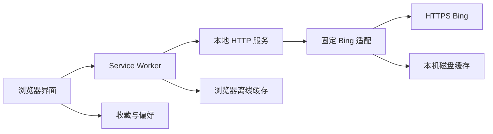

# 本地 Web 架构

状态：**CURRENT**。依据为 2026-10-17 当前源码；实际运行证据见 [原验证记录](../../VERIFICATION.md)，维护规则见 [规则目录](../rules/README.md)。这是独立实现，原生 UWP 架构仅为 [LEGACY 设计参考](../reverse-engineering/README.md)。尚未实施的部署/账号/桌面集成不属于 CURRENT。

## 模块及数据所有权

| 模块 | 职责 / 公开边界 | 数据所有者 | 允许依赖 |
| --- | --- | --- | --- |
| `server.mjs` | `createApp`、HTTP 路由、静态白名单、Host/方法检查、启动 | HTTP 响应及监听生命周期 | `lib/bing.mjs`、Node 内置模块、`public` 白名单文件 |
| `lib/bing.mjs` | `createBingService`、市场/图片校验、日期转换、上游与缓存 | `.cache/archives`、`.cache/images`、内存缓存与同键在途请求 | Node 内置模块、固定 HTTPS Bing 端点 |
| `public/app.js` | 展示、下载、收藏、偏好、模态框和可见性计时器 | 同源 localStorage、页面内存、下载 Blob URL | 本地 `/api/*`、DOM 与浏览器 API |
| `public/sw.js` | 网络失败回退、外壳/归档/图片缓存 | 浏览器 Cache Storage | 同源 GET、浏览器缓存 API |
| `test/app.test.mjs` | 合约和边界回归 | 独立临时目录和临时本机端口 | 导入服务与适配模块、假上游；不需要真实 Bing |
| `docs/reverse-engineering/source` | 历史静态资料 | 只读证据快照 | 仅供阅读，不被应用导入或静态服务暴露 |

## 依赖边界

前端不直接读取磁盘或逆向资料；浏览器向同源 API 请求。服务端不能接受任意远端 URL、任意文件路径或调用原生应用。Bing 模块不依赖 DOM，测试可注入 `fetchImpl`、时间与独立缓存目录。图片真实解码仍由浏览器完成；服务的 JPEG 响应校验不是完整图片解码。

静态资源使用明确白名单。新增文档、问题单和证据不会自动变成 HTTP 可访问文件。改监听地址、Host/CSP、路由、上游来源、持久化格式或系统集成时，按 [变更分流](../governance/CHANGE_TRIAGE.md) 完整评估安全和数据边界。

## 生命周期与演进

服务退出不维持后台任务；浏览器页面关闭后不继续每日更新。服务磁盘与浏览器存储分别管理，清理其中一方不会自动清理另一方。改变端口会改变浏览器来源，收藏/缓存随之隔离。

目前无数据库服务、用户账号、第三方运行依赖、打包步骤或公开部署。未来若增加桌面辅助服务、跨设备同步或外网监听，应另建 TARGET 架构记录、授权模型与迁移/回退计划，通过验证后才更新 CURRENT。无需为了此次文档接入修改应用结构。
