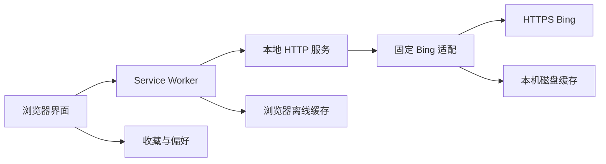

# 本地 Web 架构

状态：**CURRENT**。应用源码基线建立于 2026-10-17，生产拓扑于 2026-10-19 现场核对。实际运行证据见 [原验证记录](../../VERIFICATION.md) 和 [发布验收](../testing/mobile-release.md)，维护规则见 [规则目录](../rules/README.md)。这是独立实现，原生 UWP 架构仅为 [LEGACY 设计参考](../reverse-engineering/README.md)。账号与桌面集成仍属后续方向。

## 模块及数据所有权

| 模块 | 职责 / 公开边界 | 数据所有者 | 允许依赖 |
| --- | --- | --- | --- |
| `server.mjs` | `createApp`、HTTP 路由、静态白名单、Host/方法检查、启动 | HTTP 响应及监听生命周期 | `lib/bing.mjs`、Node 内置模块、`public` 白名单文件 |
| `lib/bing.mjs` | `createBingService`、市场/图片校验、日期转换、两批归档合并、上游与缓存 | `.cache/archives`、`.cache/images`、内存缓存与同键在途请求 | Node 内置模块、固定 HTTPS Bing 端点 |
| `lib/history.mjs` | 本站月索引、导入适配、入库和同步状态 | HISTORY_DIR 月 JSON 与 sync.json | 注入上游、media、errors/jpeg |
| `lib/media.mjs` | 完整解码、原图/640 缩略图/1920 预览、摘要检查 | HISTORY_DIR/media | Sharp、Node 文件系统 |
| `lib/owned-index.mjs` / `lib/github-file.mjs` | 自有数据分支同步、受限 GitHub JSON 读取 | 调用 history 写入 | 固定 GitHub/Bing 端点 |
| `lib/jpeg.mjs` / `lib/errors.mjs` | JPEG 结构检查 / 公共 HTTP 错误 | 无持久状态 | Node Buffer / 无依赖 |
| `public/app.js` | 展示、下载、收藏、偏好、模态框和可见性计时器 | 同源 localStorage、页面内存、下载 Blob URL | 本地 `/api/*`、DOM 与浏览器 API |
| `public/sw.js` | 网络失败回退、外壳/归档/图片缓存 | 浏览器 Cache Storage | 同源 GET、浏览器缓存 API |
| `test/app.test.mjs` | 合约和边界回归 | 独立临时目录和临时本机端口 | 导入服务与适配模块、假上游；不需要真实 Bing |
| `test/browser-ui.test.mjs` | 完整前端脚本的全屏、缩略图与焦点状态回归 | 隔离 DOM/浏览器 API 替身 | Node 内置 vm；真实布局另用浏览器验证 |
| `test/service-worker.test.mjs` | 外壳和图片缓存失败路径 | 隔离 Cache Storage/网络/计时器替身 | Node 内置 vm，执行完整 sw.js；真实配额另行验证 |
| `test/resource-limits.test.mjs` | 资源池、冷却与 HTTP 条件请求 | 临时目录、回环端口、假上游 | 服务和适配模块，独立于公网配置 |
| `docs/reverse-engineering/source` | 历史静态资料 | 只读证据快照 | 仅供阅读，不被应用导入或静态服务暴露 |

## 最近十五日数据流（1.1.0）

服务将一次归档刷新拆成 idx=0/7、n=8 的两个并行请求，共用 20 秒预算；分别校验后按 ID 去重、日期排序，最多保留 15 项，完整提交。`schemaVersion` 仍为 1，新增 `windowDays=15` 使旧七张缓存优先刷新，失败仍可回退。详见 [目录规则](../rules/catalog.md) 与 [缓存规则](../rules/cache.md)。

浏览器按真实列表长度浏览，桌面以五列三行容纳完整十五日，窄屏保留横向滚动；首页页脚新增 GitHub 仓库入口。外壳版本独立更新，原收藏键与数据/图片缓存命名保留。此次验收见 [十五日测试设计](../testing/fifteen-day-archive.md)。

## 依赖边界

前端不直接读取磁盘或逆向资料；浏览器向同源 API 请求。服务端不能接受任意远端 URL、任意文件路径或调用原生应用。Bing 模块不依赖 DOM，测试可注入 `fetchImpl`、时间与独立缓存目录。图片真实解码仍由浏览器完成；服务的 JPEG 响应校验不是完整图片解码。

静态资源使用明确白名单。新增文档、问题单和证据不会自动变成 HTTP 可访问文件。改监听地址、Host/CSP、路由、上游来源、持久化格式或系统集成时，按 [变更分流](../governance/CHANGE_TRIAGE.md) 完整评估安全和数据边界。

1.1.1 由 Bing 服务统一拥有上游执行槽、等待队列和市场刷新冷却；HTTP 层负责静态 ETag/304 与繁忙重试头；Service Worker 负责外壳超时/5xx 回退和串行图片缓存预算；UI 保留缩略图节点并接收离线保存失败提示。限值与状态语义见 [缓存规则](../rules/cache.md)、[浏览器状态](../rules/browser-state.md) 和 [HTTP 规则](../rules/catalog.md)。持久化 schema 与数据所有权不变。

## 生命周期与演进

服务退出不维持后台任务；浏览器页面关闭后不再刷新界面，1.2.0 的中国区每日索引采集由仍在运行的 Node 服务继续执行。服务磁盘与浏览器存储分别管理，清理其中一方不会自动清理另一方。改变端口会改变浏览器来源，收藏/缓存随之隔离。

目前应用无数据库服务、用户账号或打包步骤；Sharp 为图片处理运行依赖，需 npm ci 安装。现有公网实例由 Nginx 提供 TLS，再转发至回环 Node 服务；systemd 管理进程，版本目录与缓存分离，详见 [环境事实](../environments.md) 与 [发布方式](../deployment.md)。未来若增加桌面辅助服务、跨设备同步或改变 Node 监听边界，应另建 TARGET 架构记录、授权模型与迁移/回退计划，通过验证后才更新 CURRENT。1.1.0 沿用上述应用模块边界。

## 1.2.0 中国区历史数据流

Bing 适配注入共享上游资源池给历史模块；近期中国区元数据成功后追加至 HISTORY_DIR。CLI 启动独立的小时采集循环，关闭服务时停止调度；createApp 工厂不会自动发起后台网络，便于隔离测试。历史 GET 只读取所选月份，归档提供者固定为 bing.npanuhin.me；历史图片以已索引日期映射到固定图片路径，前端不接触远端任意 URL。

持久化月索引与可淘汰图片分开存放。单进程串行原子更新避免并发丢失；没有数据库、迁移或新运行依赖。一个 HISTORY_DIR 不能由多个进程同时写入。来源、回退和加载规则统一见 [历史规则](../rules/history.md)。

## 1.3.0 双来源历史

历史模块按所选月份并行读取适用的固定来源：2018-09 起 zxyongyo 的 GitHub 月 JSON，2024-04 起再合并 npanuhin 的索引。Bing 每日索引优先，逐来源维护有效期和失败冷却，单源错误不丢弃另一源及本地数据。只在同一图片 ID 上共享副本与 Bing 备用链接，图片回退共用一次 20 秒预算。schemaVersion 1 增加可选字段，原文件无需离线迁移；页脚集中标注两项目。

1.3.1 为原始文件传输异常追加同仓库官方 API 读取，依旧使用同一共享资源池与总体超时；解码严格匹配的文件响应，不跟随 API 返回的 URL。

## 1.4.0 当前数据链路

历史导入工具 → 两来源固定月文件/图片 → 本站 HISTORY_DIR。之后访客 history API 仅从该目录读取月索引和媒体；最近精选仍按既有 Bing 流程读取。旧版本段落中的访客请求触发上游、原图临时缓存语义至此被取代。

GitHub Actions → Bing 最近十五日 → 本仓库 codex/wallpaper-data 月文件/latest.json；服务后台 → 自有分支 → 校验元数据 → 两张并行保存 Bing 原图 → Sharp 派生缩略图/预览。浏览器每月只加载可见缩略图和当前预览，下载独立请求原图。PNG/WebP/任意 URL 不在适配范围。

原图文件和媒体清单独立于临时 .cache，服务单进程写入；完整导入和迁移用隔离目录，旧目录保留回滚。运行依赖和环境变更见 TECH/环境事实；具体规则不在本页重复。
