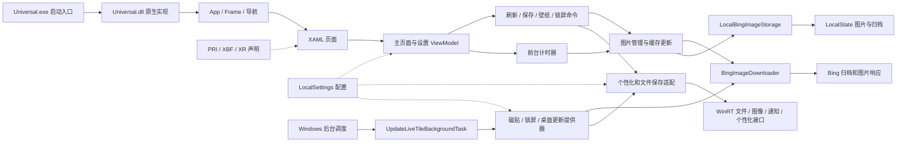

# Daily Picture 架构总览

对象：本机安装的 Daily Picture `1.4.13.0` x64；记录日期：2026-10-17。它是一个以 Bing 每日图片为数据源的 UWP/XAML 客户端，包含前台图片浏览与命令、独立的图片/归档存储、系统壁纸/锁屏适配、动态磁贴和后台任务。

**架构可概括为：XAML 页面与 ViewModel 组织交互，图片管理器协调下载和本地索引，下载器处理 Bing 响应，存储层负责名字与文件生命周期，平台适配器负责设置、个性化和磁贴；前台计时器与 Windows 后台任务是两种不同的触发机制。**

本图是基于已恢复职责的逻辑视图，不是原始项目引用图或完整函数调用图。实线表示已支持的职责流，虚线表示资源/配置供给；精确调用地址和证据另列在 [函数索引](docs/function-map.json)。



## 1. 物理架构与逻辑组件

安装包只有一个很小的启动 EXE 和一个主要原生 DLL；Appx 声明 .NET Native Framework/Runtime 1.7、VCLibs 140，主 DLL 没有常规 CIL 实现目录。`Service.winmd` 负责后台 WinRT 组件元数据，PRI/XBF/XR 负责界面资源和保留声明。

编译信息资源中确实列出 `Duracellko.BingImage.Model.dll`、`Duracellko.BingImage.UI.dll` 和 `Newtonsoft.Json.dll` 等输入。因此 Model/UI 分层有交付物线索支持，但它们没有作为独立文件部署在这份包中，原始解决方案和源码目录没有恢复。

| 层 | 组件或角色 | 主要责任 | 证据级别 |
|---|---|---|---|
| 激活与生命周期 | `Universal.App`、Frame、导航器 | 前台启动、窗口激活、导航、立即完成挂起 deferral 和局部显式释放 | 包声明 + native 调用 + WinRT ABI |
| 视图 | MainPage、ApplicationSettingsPage、AboutPage | 展示、绑定、操作入口和关于链接 | PRI/XBF/XR + 加载代码 |
| 表现逻辑 | 主页面/设置 ViewModel、命令、转换器 | 选中项、忙碌状态、命令可用性、通知、计时器 | 元数据 + 定向 native 恢复 |
| 应用协调 | 图片管理器与外层缓存更新 | 本地列表、下载循环、索引提交、清理时序 | 已恢复的状态机 |
| 网络 | BingImageDownloader、请求桥 | 列表格式化、HTTP 响应与 JSON、图片字节 | 指令 + 匹配框架符号 |
| 存储 | LocalBingImageStorage、FileHelper | JSON/图片文件、名称、存在判断与清理 | 指令 + WinRT ABI |
| 设置 | ApplicationData / 设置访问器 | 两个自动开关、三份 Current URL、局部迁移 | 指令 + 键字面值 + ABI |
| 平台适配 | 磁贴、锁屏、桌面和保存提供器 | 文件转换、去重、系统请求与通知 | native 调用 + ABI，部分语义仍限定 |
| 后台 | UpdateLiveTileBackgroundTask | deferral、顺序更新和完成 | 清单 + native 状态机 |

具体版本、全部包文件和普通/自定义导入见 [安装包与依赖](docs/packaging-and-dependencies.md)。编译输入清单不能充当运行时全依赖图，框架中出现某个类型也不证明应用实际使用该功能。

## 2. 前台启动、交互和调度

启动路径创建或复用 Window.Content 中的 Frame。只有新建 Frame 的分支读取 ApplicationLanguages 的第一个语言项，将其设为界面 FrameworkElement.Language，并初始化事件与导航器；Frame 内容为空时导航 MainPage，随后激活 Window。这里的语言赋值属于 UI 属性，不能当成 HTTP `Accept-Language` 或 Bing 市场参数赋值。

Frame.Navigated 有 App 与 Navigator 两条处理路径：App 在新 MainPage 尚无 DataContext 时订阅该页 Loaded，Navigator 则按页面类型创建并赋入 ViewModel；随后 MainPage.Loaded 触发后台任务注册入口。这是页面 Loaded 事件，不能根据早期证据文件名误记为 DataContextChanged。

页面资源提供 Refresh、Save、设置桌面、设置锁屏、Settings、About 等命令入口；主界面包含 Images、SelectedIndex、ImageSource、Description、IsBusy、NotificationMessage 等绑定字段。XBF 元数据和 XR 不等于完整控件树，已恢复的命令连接以相应 native 证据为准。

主页面 ViewModel 构造会发起本地图片加载和网络图片下载两条异步操作；它们的启动顺序可见，但不能据此断言异步完成顺序。加载后的列表非空时选中最后一项；下载服务返回有更新时会重载列表并调用磁贴服务。已配置两类前台计时器：通知的 5 秒消隐和 1 小时的下载/刷新触发。Save 要求已选中图片且不忙碌，Refresh 要求不忙碌；前台计时器直接进入刷新执行入口，另有“已在下载”的内部保护。具体委托、门控、保存和错误通知路径见 [UI 与生命周期](docs/ui-and-lifecycle.md)。

前台 1 小时计时器属于运行中的应用对象；它与 Windows 后台 `TimeTrigger(60, false)` 不是同一计时器。不能把两项配置相加或直接换算成实际每小时运行次数。

### 2.1 App 挂起、恢复与清理链

真正的 App 构造器 `0x180461e60` 在初始化 Application 后注册 Suspending，处理器是 `0x180461f60`。完整已解正常路径只有 `args.SuspendingOperation.GetDeferral().Complete()`，没有状态保存、下载等待、计时器 Stop 或 VM Dispose；托管 EH 表尚未完整解析，不能把正常路径进一步扩大成所有异常处理已排除。完整启动入口虽读取 PreviousExecutionState，却不按这个值分支恢复导航栈；复用仍存在的 Frame 与从持久化状态重建会话是不同机制。当前已证明的应用生命周期事件订阅是 Suspending；Resuming/EnteredBackground 等仅确认存在框架投影，尚未建立应用处理器链。

显式清理职责分布在三个对象中，不能把它们串成未获证实的自动退出流程：

| 对象 / 入口 | 已恢复的清理内容 | 已知边界 |
|---|---|---|
| App，`0x180531f50` | Navigator 非空且可转 IDisposable 时调用并清空 App+0x58 | 未建立挂起或退出调用此入口的链 |
| Navigator，`0x180531e60 → 0x180531e90` | 解除自己订阅的 Frame.Navigated，写 disposed 标志 | 不访问页面 DataContext，不继续释放主 VM |
| 主 VM，`0x180531e10` | 停止 +0x30/+0x38 两只前台计时器，SuppressFinalize(this) | 不移除 Tick、不清字段；自动调用者未建立 |

主 VM 双 Stop 的实现已确认。导航转发回调 `0x1804a1c30` 只更新系统返回按钮可见性，没有释放旧页面或 VM。由此可以明确：已恢复的挂起与导航路径没有调用主 VM 清理；它在其他间接路径何时被调用、对象何时不可达和 GC 回收仍需运行证据。另有一处静态异常细节：App.Dispose 的 SuppressFinalize 参数为新装箱的 false，不能据此认为 App 自身终结已被抑制，也未据此认定实际泄漏。

完整方法、事件接口、候选引用范围与伪代码见 [挂起与恢复](docs/suspend-and-resume.md) 和 [计时器与释放](docs/timers-and-disposal.md)。

### 2.2 图片显示、读取流与对象寿命

图片项保存记录、图片服务和 ImageSource。`ImageSource` getter `0x1804a9680` 只检查源是否为 null；为空就发起 async-void 加载，然后返回当前值。UI 状态机 `0x1804a8af0` 的完整顺序是：

```text
经图片服务接口取得读取流并等待
  → 创建 BitmapImage
  → await IBitmapSource.SetSourceAsync(stream)
  → 赋入图片项 ImageSource，发送 PropertyChanged
  → Dispose 临时读取流
```

本地流生产实现已另行追到 `GetImageFile → IRandomAccessStreamReference.OpenReadAsync`；UI 接口 cell 到该实现的 Native dispatch 具体槽仍是高置信候选，专题图保留虚线。这里没有把磁盘下载、UI 读取流与 BitmapImage 解码合成一次操作。

Image.Loaded 注册 SourceProperty 变化回调并把令牌保存到 Image.Tag；Image.Unloaded 只用该令牌注销属性回调，不清 Tag、Image.Source 或图片项 ImageSource，也不取消正在进行的加载。读取流在正常完成及异常展开时有显式 Dispose，成功发布的 BitmapImage 则继续由图片项持有；集合 Clear 只移除集合引用，不逐项 Dispose。

Source 变化回调还会经 Dispatcher 排队修正选择位置：图片的父 ContentPresenter 内容与列表最后一项相同时，将该项存入 **MainPage+0x58**，再把 SelectedIndex 先设 0 后设末项。因此旧项可能在集合清空后仍通过页面字段可达。该字段与 **App+0x58 的 Navigator 是不同对象的字段**，不能混用偏移推断角色。

加载入口没有共享 in-flight Task 或正在加载标志；源仍为空期间多次进入 getter 可以发起独立加载。Unloaded 也不撤回已经排入 Dispatcher 的动作。这些是静态的重入和持有条件；是否实际发生重复读盘、旧图长期保留或显示问题，需要运行记录。

| 层次 | 已恢复的清理 | 不由该操作证明的结果 |
|---|---|---|
| 磁盘缓存 | 按归档保留名删除 Images 文件 | 已显示 BitmapImage 立即释放 |
| 本次读取流 | 加载正常完成或异常展开时 Dispose | 图片项中的 ImageSource 被清空 |
| 控件观察回调 | Image.Unloaded 注销 SourceProperty callback | 已排队动作取消、图片项或页面已回收 |
| 图片对象 / 渲染资源 | 可追踪托管字段和临时引用的增减 | 最后一条引用、COM/native/GPU 资源的实际释放时刻 |

完整字段、异常清理、事件连接与持有关系见 [图片加载与释放](docs/image-loading-and-lifetime.md)。显示加载的错误交给 AsyncVoidMethodBuilder.SetException，所见路径没有下载命令使用的友好错误通知；最终呈现方式未运行观察。

## 3. 图片下载、索引与文件生命周期

进入恢复出的缓存更新方法后，顺序是：

```text
创建/打开 Images
  → 读取旧 ImageArchive.json 的 URL 列表
  → 请求新 Bing 归档（默认 n=7）
  → 按响应顺序逐张处理
  → 若本轮有实际下载：保存新归档
  → 外层仅在 true 结果后清理旧图
```

每张图片只有“旧索引的完整 URL 命中”和“派生文件名存在”都成立时才跳过；比较忽略大小写。命名优先取第一个 `id` 参数，否则 `Path.GetFileName(originalUrl)`。网络图片先完整复制到 MemoryStream，再得到 byte[]；存储层以 ReplaceExisting 创建图片文件并写入字节。

缓存淘汰读取持久化索引，保留所有索引 URL 对应的名字，删除 `Images` 中其余文件。它没有独立的 7 张硬上限、TTL 或 LRU。`Wallpaper`、`LockScreen`、`LiveTiles` 则共用保留单个指定名称的清理助手，生命周期与 `Images` 不同。

若所有图片命中，仅版权/顺序/列表子集变化不足以触发索引保存和清理；若中途失败，先前写好的文件不会回滚。首次没有索引被当作空列表，但坏索引读取/解析异常向上传播。详细算法、边界和失败矩阵见 [网络与下载](docs/network-and-download.md)、[数据与存储](docs/data-model-and-storage.md) 和 [深入恢复](DEEP_ANALYSIS.md)。

## 4. 设置和迁移

设置访问器基于 `ApplicationData.Current.LocalSettings.Values`，重要键是：

| 键 | 角色 |
|---|---|
| `UseBingImageAsDesktopBackground` | 自动桌面更新开关；缺失时 false |
| `UseBingImageAsLockScreen` | 自动锁屏更新开关；缺失时 false |
| `CurrentLiveTileImageUrl` | 磁贴当前图片标识 |
| `CurrentDesktopBackgroundImageUrl` | 桌面当前图片标识 |
| `CurrentLockScreenImageUrl` | 锁屏当前图片标识 |

缺失值和类型错误不是同一分支：读取含字符串或 Boolean 的强制类型转换；不能描述为任何非法值都自动回退。两个 Boolean 的缺省 false 已由代码与 `Nullable<Boolean>.GetValueOrDefault` 符号共同确认。

启动中可见的漫游迁移只处理 `UseBingImageAsLockScreen` 和 `CurrentLockScreenImageUrl` 两个键。Roaming 值非 null 时，它覆盖同名 Local 值，随后把 Roaming 同名项设 null；不是显式 Remove，也不是图片缓存或所有设置的全量迁移。相关 getter/setter 地址和迁移操作见 [数据与存储](docs/data-model-and-storage.md)。

## 5. 后台与系统个性化

后台注册请求使用任务名 `UpdateLiveTileTask`，入口为 `Duracellko.BingImage.Universal.Service.UpdateLiveTileBackgroundTask`，配置 60 分钟重复 TimeTrigger，同时加 InternetAvailable 与 FreeNetworkAvailable 条件。按名称找到已有注册时跳过重复创建；旧维护任务名称还有单独的清理路径。它们是静态配置请求，不证明当前注册状态或实际执行间隔。

后台 Run 取得 deferral，顺序调用三个更新提供器，完成时走 deferral.Complete。结合构造、相对方法表和各提供器方法的已解行为，顺序恢复为磁贴 → 锁屏 → 桌面。精确方法表布局只对已检查类型作静态推导，没有冒充通用完整 .NET Native EEType 解析器。

三条后台更新路径各自调用带数量参数的归档入口，并传入 `n=1`。它们共享一个下载器对象，但没有观察到共享同一次归档响应；锁屏/桌面还先检查系统提供器返回的布尔条件及自动开关。前一条件的支持性语义是静态派生，未声称两个分支都直接调用同一个 WinRT IsSupported。返回的当前 URL 与相应 `Current*ImageUrl` 按 OrdinalIgnoreCase 比较，未变化时跳过后续图片获取和系统提交。这与前台默认 `n=7` 的批量缓存更新是两种编排。

平台适配包括图像解码/缩放/编码、保存派生文件、WinRT 磁贴通知、个性化支持检测与 TrySet 类调用，以及成功后的 Current URL 与旧文件处理。桌面/锁屏 TrySet 返回 false 时，所恢复的分支删除刚用于设置的文件并抛异常，因此不会进入上层后续 Current URL 写入；不能把“异步调用完成”当成“系统设置成功”。前台缓存批量更新与后台提供器各自的取图路径必须分开，不能因为共用下载器就推断共用一份已下载列表。

各提供器的输入数量、去重条件、图像格式、系统 API 槽位和异常分支详见 [后台与个性化](docs/background-and-personalization.md)。返回 false、异常被某个 catch 匹配和系统实际显示效果三者不能混为一谈。

磁贴图像按比例缩放后居中裁切为 310×150，使用 Fant 插值和 PNG 编码；文件扩展名仍可能来自原 URL。通知通过 `ms-appdata:///local/LiveTiles/` 引用图像，到期时间设为构造通知时的 `DateTimeOffset.UtcNow.AddDays(2)`。

补充的 WinMD/ABI 核对确认磁贴解码选择无参 `GetPixelDataAsync()`，读取尺寸却使用 PixelWidth/PixelHeight。该重载的公开合同遵循 EXIF 方向并在有内嵌配置时转换到 sRGB；方向导致宽高交换时可能出现像素顺序与原始尺寸解释不一致。这是尚未用样本复现的条件性推导，且不能推广到前台 BitmapImage 加载。具体字节、重载、官方合同与边界见 [后台专题 BGA-21](docs/background-and-personalization.md)。

## 6. 外部边界和一致性

应用请求模板没有显式市场参数，界面语言不等于市场选择。HTTP 创建到发送的所见路径没有应用层语言头赋值，默认 Cookie 路径关闭；实际系统补头和 Bing 的服务端选区仍无目标运行记录。因此地区架构的正确边界是“客户端请求形成过程已恢复，服务端最终决策待观察”。

持久化也有明确边界：图片、归档、Current URL 设置和系统个性化操作不是一个跨系统事务。失败后可能出现文件与索引/当前标识短暂不同步，相关结论是控制流推导，未做破坏性故障实验。

## 7. 证据导航与完整性边界

- 重点函数的 VA/RVA、范围与 Evidence ID：[JSON](docs/function-map.json) / [CSV](docs/function-map.csv)。
- 架构组件及结论关联：[architecture-ledger.json](docs/architecture-ledger.json)。
- 每项请求的覆盖情况：[coverage-and-evidence.md](docs/coverage-and-evidence.md)。
- 明确保留的未知问题：[unknowns.json](docs/unknowns.json)。
- 原始工具索引与验证：[REA 索引](evidence/index.json)、[机器码核验](evidence/validation.json)、[文档核验](evidence/architecture/documentation-validation.json)。

本档案覆盖了本次关注的全部架构领域，并为每个领域记录已知细节与具体缺口。它没有声称恢复全部源方法、每个 XBF 节点、所有异常类型或服务端代码；这些边界决定了哪些结论可以直接作为复查依据，哪些仍需要新的证据。
