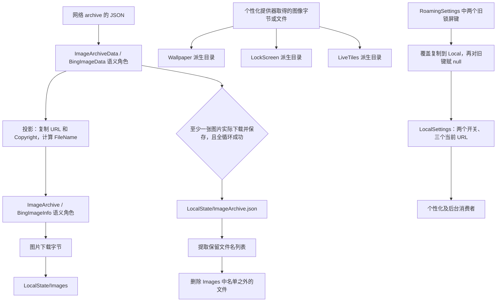

# Daily Picture 数据模型、文件存储与设置架构

本文记录本机 Daily Picture `1.4.13.0 x64` 的静态恢复结果，覆盖模型转换、JSON 索引、图片缓存、派生目录、Local/Roaming 设置及失败边界。它可以独立阅读；下载与地区的其他细节见 [network-and-download.md](network-and-download.md)，UI 与后台触发由对应架构文档说明。

分析对象为：

```text
C:\Program Files\WindowsApps\14403Duracellko.NET.BingImageoftheDay_1.4.13.0_x64__1wy5t1va6xay4\Duracellko.BingImage.Universal.dll
SHA-256 d9c4f3d1803ed27c3da21c1e70164423166c1460f53f0020f4ac2c68b413033a
```

以下 `0x180…` 均为该 PE 的首选映像地址，不能直接当作当前进程地址。只读取安装文件及已保存的本地状态证据；没有运行 Daily Picture、调用它的设置 API、下载其图片、改写缓存、挂载设置 hive 或注入故障。伪代码表达恢复的语义，并非原始源码。`DATA-xx` 为本篇可引用结论编号，完整 REA JSON、辅助解析和 SHA-256 清单见 [architecture-data 证据目录](../evidence/architecture-data/evidence-manifest.json)。

## DATA-01：分层与数据流

这份构建有三个不同层次的数据：网络/持久化传输对象保存 `images → url/copyright`；领域对象在 URL 和版权之外计算文件名；UI、壁纸、锁屏和磁贴消费这些数据。图片字节与 JSON 索引分开保存，当前已经用于个性化的 URL 又保存在独立设置库中。



图中类型名来自本机 NativeFormat 名字记录、模型字段访问与相关调用的交叉定位。主 DLL 的完整 PDB 不可用，尚未还原全部 NativeFormat 类型图；因此“某个 EEType 一定就是某个原始 C# 完整类型名”仍有限制。实际的字段复制、字符串处理和文件/API 调用是指令层观察，置信度高于原始类型名归属。

图中主缓存与个性化输入分开表示。前台选中图的操作和后台自动更新是不同调用路径；后台三个提供器分别取得单图 archive 并直接下载各自图片，不必经过 `Images` 主缓存。不能把三个派生目录都画成由 `Images` 复制产生，详细触发与提供器调用见后台架构档案。

| 类型/角色 | 可确定的职责 | 证据边界 |
|---|---|---|
| `ImageArchiveData` / `BingImageData` | JSON 数据对象；读取 archive 后用集合和 URL/版权生成领域列表 | 元数据存在这些名字，本地 JSON 和转换代码支持此角色；尚未完整解出每个字段的声明属性 |
| `ImageArchive` / `BingImageInfo` | 图像集合及单张图像的 URL、版权、计算出的文件名 | `0x1804b9190` / `0x1804b9510` 直接显示转换；名字与 EEType 的一一对应为强语义推断 |
| `LocalBingImageStorage` | 初始化主图片目录，读取/保存索引，检查/保存/取得图片，清理旧图 | 由完整异步状态机和 WinRT 存储调用确认 |
| `BingImageManager` | 读取旧 URL 集合，请求新列表，逐张决定是否下载，决定是否提交索引 | `0x1804b9f40` 的执行顺序确认 |
| `ISettingsRepository` / `SettingsRepository` | 两个 Boolean 开关、三个当前图像 URL、旧设置迁移 | 名字记录、五个键的精确字面量与十个读写方法确认 |
| `BingImageItem` | UI 项目角色 | 元数据可见该名字；它的完整通知/命令和字段图由 UI 文档处理，本篇不把它等同于 JSON DTO |

可复查的名字位置包括 `BingImageInfo` 字符串 `0x1801aa385`、`BingImageData` 字符串 `0x1801cd389`，以及包含 `ImageArchiveData`、`LocalBingImageStorage`、`SettingsRepository` 等名字的原始 metadata 窗口。[native-data-index.json](../evidence/architecture-data/native-data-index.json) 保留了原始字节和地址；字符串邻近本身不证明字段归属。

## DATA-02、DATA-03：JSON 结构与内存模型转换

2026-10-17 16:32:01（Asia/Shanghai）采集的 `LocalState\ImageArchive.json` 是 1,403 字节的 UTF-8 JSON，SHA-256 为 `c3be13096bc893f9cba52998905b70273187a88bb7008e909a692d066aab828b`。快照中有 7 个元素，顶层只有 `images`，每个元素只有 `url` 和 `copyright`，二者都是字符串。这里展示等形示意，不是对网络服务的全部字段定义：

```json
{
  "images": [
    {
      "url": "/th?id=OHR.Example_EN-US123_1920x1080.jpg&rf=LaDigue_1920x1080.jpg&pid=hp",
      "copyright": "Description (© Photographer/Agency)"
    }
  ]
}
```

完整原始记录保存在 [ImageArchive.observed.json](../evidence/local-state/ImageArchive.observed.json)。不能把“本地序列化结果只保存这两个字段”扩展为“Bing 返回只含这两个字段”，也不能从这个正常样本推导所有字段的 required/nullable 规则。应用内存在 JSON reader/writer 与 serializer 调用；编译元数据包含 Newtonsoft.Json，具体组件版本及构建关系见 [packaging-and-dependencies.md](packaging-and-dependencies.md)。尚未完整恢复 JsonProperty、converter、contract resolver、未知字段、日期、重复键等全部反序列化选项。

`0x1804b9190` 与选择器 `0x1804b9510` 的可读恢复如下：

```csharp
// 名称表示恢复出的语义；偏移表示本构建 x64 对象布局。
ImageArchive Project(ImageArchiveData data) {
    if (data == null) throw new ArgumentNullException(/* observed guard */);
    Images = data.Images == null
        ? new List<BingImageInfo>()
        : new List<BingImageInfo>(data.Images.Select(ProjectItem));
}

BingImageInfo ProjectItem(BingImageData item) {
    // selector 在读取 item+8/+0x10 之前没有 item == null 分支
    var result = new BingImageInfo();
    result.Url = item.Url;
    result.Copyright = item.Copyright;
    result.FileName = GetImageFileName(result.Url);
    return result;
}
```

| 指令观察 | 对应语义 | 强度 |
|---|---|---|
| `0x1804b91a9..4b91ac` 检查输入对象，转 `0x1804b94d7` 异常构造 | null archive 不被当作空对象 | 已证实 |
| `0x1804b91b2` 读取输入 `+0x08`，为空转 `0x1804b947e` | null 图像集合被转换为空 List | 已证实 |
| `0x1804b9476` 调用匹配框架符号的 `List<T>` 构造器，`0x1804b94bc` 写入目标 `+0x08` | 投影被立即实体化；异常可在构造时发生 | 已证实 |
| `0x1804b9517/4b951b` 读输入 `+0x08/+0x10`，`4b953f/4b954c` 写目标同偏移 | URL 与版权复制 | 偏移直接确认；字段语义由下游 URL 处理与样本支持 |
| `0x1804b9556` 调 `GetImageFileName`，`4b9562` 写目标 `+0x18` | 文件名是派生值，不是从 JSON 原样读入 | 已证实 |

选择器分配的 EEType 为 `0x180004d58`，其记录中的 base size 为 `0x28`。这些是本机编译布局，不能作为跨版本持久化格式。null 条目会在字段读取时失败；null/空 URL 会在文件名 helper 的参数检查失败；畸形 URI 也可使底层 URI 构造失败。没有看到将坏条目跳过、替换为占位对象或保存到独立错误队列的分支。

证据：`DATA-02/03`，[model-observations.json](../evidence/architecture-data/model-observations.json)、[reused-model-projection.asm](../evidence/architecture-data/reused-model-projection.asm)，完整 REA `storage-json.json` / `ev_e559ec21919cdf6b212f0ca080a9bd67dc539290d48532d43846200b774840eb`。

## DATA-04、DATA-05：本地索引读写与提交边界

索引路径位于 `ApplicationData.Current.LocalFolder` 根目录。读取实现 `0x1804b96b0` 先枚举根目录文件，利用 `0x1804a0220` 谓词按 `OrdinalIgnoreCase` 比较 `ImageArchive.json`，然后才打开目标、读取并反序列化。

| 输入情况 | 恢复出的分支 | 影响 |
|---|---|---|
| 根目录没有该名字 | `0x1804b98a0` 分支最终返回 null | 管理器 `0x1804b8d60` 把 null 转成空 URL 列表，首次下载可继续 |
| 索引存在且正常 | 打开、读取、反序列化后返回数据对象 | 后续以 URL 列表判断缓存命中 |
| 打开/读取/反序列化抛异常 | `0x1804b9ac0` handler 调用 async builder 的 SetException | 不转换为“首次运行”；在网络列表请求之前就可阻止本次协调器继续 |
| JSON 解析得到 null 对象 | 下游 null 分支可视为空旧索引 | 是否哪些文本输入会得到 null 属于 serializer 语义；未逐一测试 |
| 非 null archive 的 `images` 为 null | 领域投影生成空列表；清理方法直接返回 | 与空数组的清理行为不同 |

“无索引文件”与“索引坏了”不是同一恢复路径。仅凭界面能够打开或磁盘上存在 JPG，无法判定本次下载协调器一定能越过本地索引读取。

保存入口 wrapper 为 `0x1804ba410`，状态机为 `0x1804ba4b0`。`0x1804ba550` 传入原文件名 `ImageArchive.json`，`0x1804ba557` 传入模式值 `1`，随后进入 `0x1804ba720` / `0x1804ba8f0`，获取 StorageFile、打开写流、构造 `StreamWriter` 并进入 JSON 写入。匹配框架 PDB 证实了 StreamWriter 构造器导入 `0x18029f5b8`。

保存过程没有观察到临时索引文件名、Rename 或跨图片与索引的事务提交。`CreateFileAsync(..., ReplaceExisting)` 是由 IStorageFolder 类型、参数和返回链共同支持的强推断；其托管 dispatch cell `0x180305620` 的具体方法槽仍未独立解码。本篇不单凭数字 `1` 把该调用写成完全证实的枚举 API。主图片的保存路径则有明确 WinRT ABI 槽位，ReplaceExisting 的证据更强。

保存失败会使 Task 失败。它没有提供“JSON 无论如何都会保持上一份完整内容”的应用层保障；具体中断后字节是否为空、部分写入、旧内容残留及落盘时序未做运行时实验。

证据：`DATA-04/05`，[reused-archive-load.asm](../evidence/architecture-data/reused-archive-load.asm)、[reused-archive-save.asm](../evidence/architecture-data/reused-archive-save.asm)，完整来源同 `ev_e559ec…`；索引名字谓词为 `ev_d49abee0c9b9b008e20bdea59903bf49e5db268e2c84c8a16089fab86924094f`。

## DATA-06：实际目录与生命周期

这台机器的 app data 根目录为：

```text
C:\Users\wangq\AppData\Local\Packages\14403Duracellko.NET.BingImageoftheDay_1wy5t1va6xay4\
├─ LocalState\
│  ├─ ImageArchive.json
│  ├─ Images\
│  ├─ Wallpaper\
│  ├─ LockScreen\
│  └─ LiveTiles\
├─ RoamingState\
└─ Settings\
   ├─ settings.dat
   ├─ settings.dat.LOG1
   └─ settings.dat.LOG2
```

该树是相关部分，应用容器还存在 AC、LocalCache、TempState 等系统目录。应用代码使用 `ApplicationData` 抽象，没有把上面这个用户绝对路径硬编码进去。`LocalSettings` 也不是 `LocalState\settings.json`；本机看到的持久化载体是 `Settings\settings.dat` hive。不要把 API 的 LocalSettings、物理目录 LocalState 和 hive 内键名 `Test\LocalState` 混为同一对象。

| 目录 | 初始化状态机 | 初始化请求 | 清理规则 |
|---|---|---|---|
| `Images` | `0x1804bb1d0` | `LocalFolder.CreateFolderAsync("Images", OpenIfExists)` | 持久化 archive 提取出的多文件保留名单 |
| `LockScreen` | `0x1804b53d0` | 同 API，名称 `LockScreen` | 个性化路径传给 FileHelper 的单个保留文件名 |
| `Wallpaper` | `0x1804b7240` | 同 API，名称 `Wallpaper` | 同上，单名保留 |
| `LiveTiles` | `0x1804bd610` | 同 API，名称 `LiveTiles` | 从当前磁贴 URL 计算的单名保留 |

后三个新解片段均传 `IStorageFolder` ABI 槽 `9` 和 `CreationCollisionOption=3`，分别在 `0x1804b545b`、`0x1804b72cb`、`0x1804bd697` 发起调用。官方 ABI 将该槽和枚举组合定义为 `CreateFolderAsync` / `OpenIfExists`。这意味着复用现有目录，不是每次初始化清空目录。初始化失败传播到 Task，没有本方法内重新命名目录或清空后重建的恢复流程。

`GetImageFile` 状态机 `0x1804bf900` 检查 URL 非空，取得 `LocalFolder/Images`，用派生文件名调用 `GetFileAsync` 后返回 StorageFile。它本身没有调用 CreateFolder 或下载缺失图片；目录/文件缺失的错误由其 Task 传播。`ExistsImage` 和 `SaveImage` 也先取得 `Images`，因此单独调用这些操作不能代替初始化。

证据：`DATA-06`，[三个新目录初始化 REA JSON](../evidence/architecture-data/evidence-manifest.json)、[reused-get-image-file.asm](../evidence/architecture-data/reused-get-image-file.asm)。接口关系通过 context→EEType→同二进制 IID 记录匹配，再对照已保存且校验 SHA 的 [Microsoft Windows Storage ABI 定义](https://github.com/microsoft/windows-rs/blob/master/crates/libs/windows/src/Windows/Storage/mod.rs)，见 [abi-and-settings-types.json](../evidence/architecture-data/abi-and-settings-types.json)。

## DATA-07：URL、文件名与命中检查

文件名提取 `0x1804a0060` / `0x1804a0100` 的规则是：

```csharp
string GetImageFileName(string url) {
    if (String.IsNullOrEmpty(url)) throw new ArgumentNullException("url");
    var uri = new Uri(new Uri("http://www.bing.com"), url);
    return GetUriQueryId(uri) ?? Path.GetFileName(url);
}

string GetUriQueryId(Uri uri) {
    string query = uri.Query;
    if (String.IsNullOrEmpty(query)) return null;
    if (query[0] == '?') query = query.Substring(1);
    foreach (string part in query.Split(new[] {'&'})) {
        int i = part.IndexOf('=');
        if (i > 0 && String.Equals(part.Substring(0, i), "id",
                                  StringComparison.OrdinalIgnoreCase))
            return part.Substring(i + 1);
    }
    return null;
}
```

这是解析 URL 的基准 URI，不代表用 HTTP 实际下载；实际下载路径见网络文档。第一个匹配的 `id` 键胜出，键不区分大小写。`id=` 得到空字符串，不走 `??` fallback；值保留第一个 `=` 之后的其余内容。未观察到显式 URL 解码、非法文件名替换或目录路径清洗；由于输入经过 `Uri.Query`，仍不能断言所有百分号编码必定逐字保留。

`ExistsImage`（`0x1804b8970`）枚举 `Images` 文件并按 `OrdinalIgnoreCase` 比较 Name，只有名字维度。没有字节长度、哈希、格式标记或图像解码验证。`SaveImage`（`0x1804b81c0`）则以派生文件名 CreateFile/ReplaceExisting，再调用 FileIO.WriteBytesAsync，没有先创建一个临时文件并原子换名。

因此完整 URL 不同但 `id` 相同的两项可能写到同一个名字；只有 URL 大小写变化会被完整 URL 忽略大小写比较判等。同名空文件或坏图片可以通过“存在”检查，这条路径不自动识别其内容损坏。

证据：`DATA-07`，完整 REA `filename.json` / `ev_f55360c578fbe40de5b04f98d6e88f52f1236b01a38164bca11767e789445e80`、`filename-predicate.json` / `ev_879efc11f566e597ee7da70eef4e712d5be735bb6d2c2401948fa33cf9048f6a`，框架 PDB 解析支持 `Uri.Query`、`Path.GetFileName`、`StringComparer.OrdinalIgnoreCase` 等名称。

## DATA-08、DATA-09：下载提交与两套清理算法

```csharp
async Task<bool> DownloadImages() {             // state 0x1804b9f40
    await storage.InitializeImages();
    previousUrls = await LoadLocalArchiveUrlProjection();
    var remote = await downloader.GetImageArchive();
    var images = Project(remote);
    bool anyDownloaded = false;
    foreach (var image in images) {
        // DownloadImage 的 false 只表示有效的双重缓存命中
        if (await DownloadImage(image.Url)) anyDownloaded = true;
    }
    if (anyDownloaded) await storage.SaveImageArchive(remote);
    return anyDownloaded;
}

async Task<bool> DownloadImage(string url) {     // state 0x1804b7e10
    if (previousUrls != null &&
        previousUrls.Contains(url, StringComparer.OrdinalIgnoreCase) &&
        await storage.ExistsImage(url)) return false;
    byte[] bytes = await downloader.DownloadImage(url);
    await storage.SaveImage(url, bytes);
    return true;
}

async Task<bool> DownloadAndClean() {            // outer state 0x180518c60
    bool changed = await manager.DownloadImages();
    if (changed) await storage.DeleteOldImages();
    return changed;
}
```

下载协调器在初始化和旧索引读取成功后，才必经新网络 archive 请求。这不是“每次窗口出现都必发请求”的断言。它串行 await 每张图片；某张图下载或写入失败会中止整个任务，未看到每项 catch 后继续。前面已经写入的图片不回滚，新索引写入点尚未到达。

索引提交判据是 `anyDownloaded`。当完整 URL 全命中且同名图片文件均存在时，仅版权、顺序变化或列表删去若干项不会使新索引保存；外层也跳过清理。网络返回非 null 的空列表同样没有新下载，因此不会用空列表替换旧索引。

主缓存清理方法 `0x1804bed50` 重新读取**已经持久化的** archive：

```csharp
async Task DeleteOldImages() {
    var archive = await ReadLocalImageArchive();
    if (archive == null || archive.Images == null) return;
    var keep = archive.Images.Select(x => GetImageFileName(x.Url)).ToList();
    var folder = await LocalFolder.GetFolderAsync("Images");
    foreach (var file in await folder.GetFilesAsync()) {
        if (!keep.Contains(file.Name, StringComparer.OrdinalIgnoreCase))
            await file.DeleteAsync();
    }
}
```

这是基于保留名单的差集删除，没有观察到按最后访问时间、修改时间、大小、容量、固定张数或 LRU 排序。null archive/null images 跳过；非 null 的空 images 列表没有保留项，会删除枚举到的全部 Images 文件。目录枚举顺序由系统返回，不应称为应用按日期排序。删除逐个 await；单个错误传播，可能在部分删除后中止。

派生目录共用另一方法 `FileHelper.DeleteOldFiles`（wrapper `0x1804b44d0` / state `0x1804b4580`）：

```csharp
async Task DeleteOldFiles(StorageFolder folder, string keepName) {
    if (folder == null) throw new ArgumentNullException("folder");
    try {
        foreach (var file in await folder.GetFilesAsync())
            if (!String.Equals(file.Name, keepName, StringComparison.OrdinalIgnoreCase))
                await file.DeleteAsync();
    } catch (/* 匹配的托管异常类型尚未恢复 */) {
        // 空 catch funclet 0x1804b482c 转回成功完成位置。
    }
}
```

它保留单个名字，调用点为锁屏 `0x1804b42e1`、壁纸 `0x1804b6e91`、磁贴 `0x1804bd42d`。可见空 catch，但未恢复精确 catch 类型，所以不能写成“所有异常都吞掉”。锁屏路径在系统 TrySet 返回 true 后才清理旧文件，false 分支先删新文件并构造异常；这只是静态成功/失败分支，不是本次已执行的系统设置结果。

证据：`DATA-08/09`，完整 `storage-json.json`、`extra-cache.json` / `ev_6da75649a5d884360afb0fedf9861d1ad2efaaf237aed1981b2a4a37d3c18b7c`、`personalization-cleanup.json` / `ev_a7a43ad582f28f2f507cbf93269f50da20a286849c8cd943567c37114d0b4a08`、`tile-cleanup-call.json` / `ev_5da8eabffe4f547dbc424b08a85d8297e9b8b14cc28fceebffd429f78cc87a19`。外层 await→bool→条件清理由 [refresh-cleanup-sequence.json](../evidence/deep-download/refresh-cleanup-sequence.json) / `ev_942fda182a00886a8532bfe6e4e76dc47d0b6ddae19c7cad395d86bd8041c909` 确认。

## DATA-10、DATA-11：五个设置键及类型行为

五个已定位键都经过同一调用链：

```text
ApplicationData.Current
  → LocalSettings
    → Values : IDictionary<string, object>
      → 精确字符串键的读/写
```

| 精确键名 | 值语义 | getter | setter | 读取 null 的处理 |
|---|---|---|---|---|
| `CurrentLiveTileImageUrl` | String | `0x1804be880` | `0x1804be7f0` | 返回 null |
| `CurrentDesktopBackgroundImageUrl` | String | `0x1804be9a0` | `0x1804be910` | 返回 null |
| `CurrentLockScreenImageUrl` | String | `0x1804beac0` | `0x1804bea30` | 返回 null |
| `UseBingImageAsDesktopBackground` | Boolean | `0x18051d510` | `0x18051d430` | false |
| `UseBingImageAsLockScreen` | Boolean | `0x18051d730` | `0x18051d650` | false |

URL getter 读取对象后调用 `RhTypeCast_CheckCastClass`，目标类型导入 `0x1802a6710` 已匹配到框架 `System.String`。setter 直接把传入值写入键，没有文件名转换、URL 规范化、非空检查或网络可达性检查。保存的是当前 URL 字符串，不能把这些键当作本地文件绝对路径键。

Boolean setter 装箱后写入。getter 先判 null；非空时强转 `Boxed_Boolean`（导入 `0x1802a6380`），取值后使用 Nullable Boolean 的 `GetValueOrDefault`。可读语义如下：

```csharp
string ReadUrl(string key) => (string)LocalSettings.Values[key];
void WriteUrl(string key, string value) => LocalSettings.Values[key] = value;

bool ReadFlag(string key) {
    object value = LocalSettings.Values[key];
    bool? flag = value == null ? (bool?)null : (bool)value;
    return flag.GetValueOrDefault();
}
void WriteFlag(string key, bool value) => LocalSettings.Values[key] = value;
```

这些方法只在返回值为 null 时使用默认值。若非 null 的值类型错误，强制转换会失败，方法体没有自己的异常恢复。不要把该逻辑表述为“任何错误设置都回退 false/null”。UWP 官方示例也用 `localSettings.Values[key] == null` 判断未设置值，但此处未调用应用 API 验证当前运行时字典行为；静态 null 分支本身已明确。[Microsoft 本地应用数据示例](https://blogs.windows.com/windowsdeveloper/2016/05/10/getting-started-storing-app-data-locally/)

用于 API 身份核对的记录如下：

| 调用 context → EEType | 同文件 IID 对应接口 | 本段使用的 ABI 槽 |
|---|---|---|
| `0x18010f488` → `0x18000cbb0` | IApplicationDataStatics | 6 Current |
| `0x18010fa20` → `0x18000cb00` | IApplicationData | 10 LocalSettings、11 RoamingSettings |
| `0x18010fa38` → `0x18000cb98` | IApplicationDataContainer | 8 Values |

每个 context 第一指针与二进制中对应 IID 记录前 24 字节的类型指针一致；ABI 槽经官方定义核对。Values 后续 dispatch cell 的类型相对指针共同指向导入 `0x1802a6fe0`，匹配的 Framework PDB 将其标为 `IDictionary<System.String,System.Object>`。这个解析说明字典类型，未声称完成所有托管虚方法槽映射。缓存文件名的 OrdinalIgnoreCase 不能直接移用为设置字典键的比较规则。

证据：`DATA-10/11`，新完整 [settings-url-and-migrate.json](../evidence/architecture-data/settings-url-and-migrate.json) / `ev_47c402db3041bed79b42a93aef6ecf773a04a45de7384f3c0f44cbf8af89e42c`，[settings-type-symbols.json](../evidence/architecture-data/settings-type-symbols.json)，四份原 Boolean 读写证据及新渲染片段见 [reuse-index.json](../evidence/architecture-data/reuse-index.json)。

## DATA-12：Roaming → Local 迁移的精确范围

`MigrateFromRoamingToLocal` 的语义 helper 为 `0x1804beb50`，恢复控制流为：

```csharp
void MigrateFromRoamingToLocal(string key) {
    var local = ApplicationData.Current.LocalSettings;
    var roaming = ApplicationData.Current.RoamingSettings;
    object value = roaming.Values[key];
    if (value != null) {
        local.Values[key] = value;
        roaming.Values[key] = null;
    }
}

void MigrateKnownLegacyKeys() {                // wrapper 0x1804bec80
    MigrateFromRoamingToLocal("UseBingImageAsLockScreen");
    MigrateFromRoamingToLocal("CurrentLockScreenImageUrl");
}
```

具体顺序：`0x1804bec0f` 读取 Roaming 值，`4bec15` 检查 null；`4bec41` 写 Local；`4bec5b` 将值参数置零，`4bec68` 通过同类字典 setter 给 Roaming 键赋 null。该方法不先检查 Local 是否已有值，因此非 null 的旧 Roaming 值会覆盖 Local 同名值。它不检查该键应当是 Boolean 还是 String，直接搬运对象；错误类型可直到后续 getter 强转时才暴露。

wrapper 只列出上述两个锁屏键。UI 启动函数 `0x180532190` 的 `0x1805321c2` 与 `0x1805321ce` 也依次调用这两次迁移，位于 Window.Current/Content 和可能创建 Frame 之前。没有看到此路径迁移三个当前 URL 的全部键、壁纸开关、整个设置容器或图片目录。

这里明确记录为 `roaming.Values[key] = null`，**没有观察到显式 `Remove(key)` 调用**。底层字典如何物理持久化 null、是否表现为删除，不等同于应用发出 Remove 操作，未在运行时测试。方法也没有自己的版本标记、批量事务、覆盖确认、回滚或 catch；若 Local 写入成功而后一步失败，Local 已可能改变，Roaming 是否清空则未知。两个键之间也没有整体事务。

证据：`DATA-12`，新 `ev_47c402…`；启动交叉证据 [app-lifecycle-candidate.json](../evidence/architecture-ui/app-lifecycle-candidate.json) / `ev_ec4ca01bd51f99b16983649e566c60e119d609e71611ae86e05593e3cb9324b2`。此结论限定为本构建的静态路径，不是本次实际执行了迁移的证明。

## DATA-13：本机已保存状态如何对应架构

以下只引用此前 2026-10-17 16:32:01（Asia/Shanghai）的只读采集，不声称现在仍与之完全一致。每个文件当时先读取、后复算 SHA，保持一致；这不构成对整个正在运行应用的协调快照。

| 保存状态 | 实际观察 | 可以支持什么，不能支持什么 |
|---|---|---|
| `LocalState\ImageArchive.json` | 7 项 `EN-US` URL，均为 `1920x1080` 名称 | 保存列表的内容；不能独自证明近期网络请求的 market 参数 |
| `Images` 与 `Wallpaper` | Sneffels 图片 SHA 相同，壁纸登记路径指向 Wallpaper 目录 | 文件内容和配置路径一致；本次没有刷新桌面、采集其显示结果 |
| `LiveTiles` | `.jpg` 文件名，但文件签名/尺寸为 PNG、310×150，名称含 ZH-CN Chauvet | 派生文件可以与主图的格式/地区不同；扩展名不保证真实编码 |
| `Settings\settings.dat` | 8,192 字节，REGF；序列号一致、头校验和有效 | 保存字节内部基本检查通过；不证明没有待写入的内存状态 |
| hive `Test\LocalState` | 只见一条可达已分配值 `CurrentLiveTileImageUrl` | 保存磁贴 URL；不能据此断言其他设置从未存在或当前一定为 false |
| hive `Test\RoamingState` | 可达值数 0 | 采集时保存字节中为空；不能证明当年迁移的时间、原因或当前同步状态 |

磁贴值是 `/th?id=OHR.ChauvetPaintingsFrance_ZH-CN3150703955_1920x1080.jpg&rf=LaDigue_1920x1080.jpg&pid=hp`，值内记录的更新时间为 2026-10-17 10:59:25.425536（Asia/Shanghai）。设置文件 SHA-256 为 `75d55a133159507db99a68371374229b55f6e21277293822f9da4761e1870707`。解析只遍历保存根下可达且已分配的 hive cell，未挂载 hive、未回放 LOG1/LOG2、未扫描已删 cell。

相关原始路径、哈希、长度、时间戳、文件头和解析限制均见 [local-state.json](../evidence/local-state/local-state.json) / `DP-LOCAL-STATE-20261017`。当前设置 getter 的默认行为是由本篇指令恢复确定的，不能用这份状态快照的“没看到”代替代码证明。

## DATA-14：异常、部分完成与仍未恢复的细节

| 操作 | 本层处理 | 可能留下的持久化状态 |
|---|---|---|
| 目录初始化失败 | SetException，后续步骤不运行 | 已有目录/内容仍由原状态决定 |
| 坏索引读取失败 | SetException，不当作首次运行 | 旧坏索引保留；本次协调器可在网络前失败 |
| 第 N 张图片下载/写入失败 | 中止循环，不逐项跳过 | 前 N−1 张可能已写入；旧 archive 尚未替换 |
| 图片 CreateFile 后写字节失败 | 错误传播，无应用层换名事务 | 同名原图内容可能已受影响，具体字节未测 |
| JSON 索引保存失败 | 错误传播，外层不清理 | 图片可能已更新，索引不一定完整 |
| 新索引成功、随后清理失败 | DeleteOldImages 错误传播 | 新索引已存在，旧图片可能部分残留 |
| 派生目录清理匹配 catch 的异常 | 空 catch 返回正常完成 | 多余派生文件可能留下；catch 精确类型未知 |
| 设置值非 null 但类型错误 | String/Boolean 强转失败 | 没有本方法内修复或重置 |
| 迁移 Local 写成功、Roaming 赋 null 失败 | 无本地回滚 | 两处值可能同时保留，需运行时才知具体状态 |

这组实现没有跨“原图写入、JSON 索引、淘汰、当前 URL 设置、Roaming 迁移”的整体事务，也没有在已检查的存储路径中发现索引校验和、版本号、临时备份或自动修复协议。该描述限于已恢复的具体方法，不能扩大为整个 UWP/文件系统完全没有内部一致性机制。

仍未解决的具体问题：

1. 主 DLL NativeFormat 的完整类型、字段、泛型与异常类型图未解出；语义角色可用，但不能交付为原 C# 定义的逐字重建。
2. JSON serializer 的所有属性、设置和特殊输入处理未覆盖；正常快照不能证明反序列化完整 schema。
3. archive 写入 helper 的 managed IStorageFolder dispatch 槽尚未独立映射；ReplaceExisting 保持强推断。
4. FileHelper 空 catch 的精确托管异常类型未恢复，不应重建为无条件 catch-all。
5. Roaming 键赋 null 的物理后端效果、同步传播及失败时序未执行验证；不会把它改写成显式 Remove。
6. 未测量前后台并发写入、系统终止、断电、空间耗尽和反序列化损坏的运行时结果；没有从静态图推导跨进程锁或精确落盘原子性。

## 复核入口与完整证据编号

新增脚本 [data_arch_inspect.py](../scripts/data_arch_inspect.py) 只运行明确路径上的限定范围 REA `pDj`，保存未裁剪 JSON 并检查 `completion_status=complete`、`output_truncated=false`、`artifact_changed=false`。辅助脚本 [data_arch_evidence.py](../scripts/data_arch_evidence.py) 校验目标 SHA，解析 IID/context 字节、重渲染已保存证据子范围、生成函数表与证据清单，不改写原 REA 文件。

| 新证据文件 | 完整 REA Evidence ID | 主要覆盖 |
|---|---|---|
| `architecture-data/settings-url-and-migrate.json` | `ev_47c402db3041bed79b42a93aef6ecf773a04a45de7384f3c0f44cbf8af89e42c` | 3 URL 键的读写、迁移 helper 与双键 wrapper |
| `architecture-data/lockscreen-folder-init.json` | `ev_6fd5dd25e7b82a80613aad05860eddb91dba0960a5380873b869f36b707dec4c` | LockScreen/OpenIfExists |
| `architecture-data/wallpaper-folder-init.json` | `ev_34c80e84001e0add58f946c000694081dca32cf2bb3209264c649c418ec62738` | Wallpaper/OpenIfExists |
| `architecture-data/livetiles-folder-init.json` | `ev_36c4008c3403c9bbab5a9297d56f199987f56884f65200745619856d50e6a544` | LiveTiles/OpenIfExists |

| 复用设置证据文件 | 完整 REA Evidence ID |
|---|---|
| `background/desktop-settings-write.json` | `ev_7084e6e44d29757c7880cdc784d6befef86e55f914dc8c3c59618477da2df0e9` |
| `background/desktop-settings-read.json` | `ev_2144bd36a54dd595233426738da38a329d73508193cd844dbb08d3d00aac944e` |
| `background/lockscreen-settings-write.json` | `ev_0af13c153f19e30616e1011b6db241a4091bf306f23a888552a19a0c40b4b697` |
| `background/lockscreen-settings-read.json` | `ev_e8c846f651cf700550f3fc4cf9256a6413d2e64134ff0bc541e018138a9749bc` |

[functions.json](../evidence/architecture-data/functions.json) 提供 22 项已核对 `.pdata` 起点的简表，供全局函数地图使用。`reused-*.asm` 只是可读子范围，文件头和 [reuse-index.json](../evidence/architecture-data/reuse-index.json) 指向完整旧 REA JSON 与原 ID，没有把重渲染冒充新观察。详细旧缓存证据及全部失败分支地址也可从 [deep-cache/findings.md](../evidence/deep-cache/findings.md) 和 [DEEP_ANALYSIS.md](../DEEP_ANALYSIS.md) 继续下钻。

所有本篇 `DATA-01..14` 的机读结论、置信度与证据路径见 [findings.json](../evidence/architecture-data/findings.json)；跨目录完整文件 SHA-256 清单见 [evidence-manifest.json](../evidence/architecture-data/evidence-manifest.json)。
