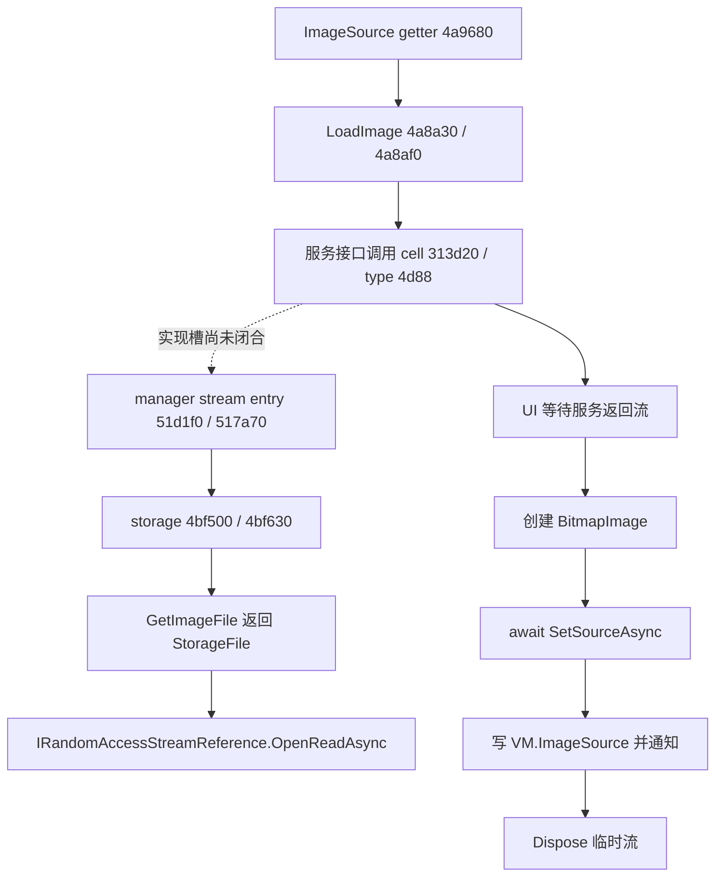

# Daily Picture 图片加载与对象寿命

本轮把此前 UI 章节未闭合的图片显示链追到了 `ImageSource` getter、异步流/BitmapImage 创建、Loaded/Unloaded 事件和属性回调。**临时读取流有显式 `Dispose`；Image.Unloaded 只注销对 SourceProperty 的观察回调，并不清空图片源或取消正在加载的任务。** 图片对象仍可能被图片项、XAML 控件、页面记忆字段或未完成的异步工作持有。这里证明的是静态调用和对象引用关系，尚未测量运行时内存、COM 引用计数或 GPU 资源释放时间。

目标为已安装 `Duracellko.BingImage.Universal.dll`，SHA-256 `d9c4f3d1803ed27c3da21c1e70164423166c1460f53f0020f4ac2c68b413033a`；所有地址是基址 `0x180000000` 下的静态 VA。分析使用独立 REA CLI 和 Cutter 2.5.0 随附 Rizin，未启动应用、调用其 WinRT API、修改设置或真实缓存。本文 `ImageItemVM`、`LoadImage`、`manager stream entry` 等名称是按语义恢复的角色，不是声称拥有应用原始 PDB。

本轮 33 份完整 REA JSON、2,232 条反汇编指令、8,278 字节已与当前安装文件逐字节核对；文件名产生于探索阶段，最终解释以本文、[结论清单](../evidence/image-lifetime/findings.json)及[来源与排除项](../evidence/image-lifetime/provenance.json)为准。[函数索引](../evidence/image-lifetime/functions.json)包含 28 个 `.pdata` 起点，另有 [WinMD/ABI 对照](../evidence/image-lifetime/abi-evidence.json)、[引用和字段审计](../evidence/image-lifetime/ownership-and-reference-audit.json)与[验证结果](../evidence/image-lifetime/validation.json)。

## IMG-01：图片项和懒加载入口

主 VM 获取图片记录后，逐项分配 EEType `0x180006080` 的对象，并调用 `0x1804a3790` 构造。构造将记录引用写入 `+0x10`、图片服务写入 `+0x18`。getter `0x1804a9680` 检查 `+0x20` 是否为空；为空则调用 `0x1804a8a30` 的 async-void 入口，然后返回当时的 `+0x20`。因此 getter 可以返回尚未就绪的空值；如果底层异步工作同步完成，也可能在本次返回时已经有图，静态代码没有强制延迟。

| 对象/字段 | 已证明的角色 | 写入或读取依据 |
|---|---|---|
| ImageItemVM `+0x08` | PropertyChanged 委托 | setter `0x1804a8d78` 读取并调用 |
| ImageItemVM `+0x10` | 图片记录 | ctor `0x1804a37a6` 写入；加载 `0x1804a8b36` 传服务 |
| ImageItemVM `+0x18` | 图片服务 | ctor `0x1804a37b3` 写入；加载 `0x1804a8b2f` 作为 receiver |
| ImageItemVM `+0x20` | ImageSource 引用 | getter `0x1804a9688`；setter `0x1804a8d49` |
| LoadImage 状态机 `+0x20` | 当前图片项 | `0x1804a8b19` 读取 |
| LoadImage 状态机 `+0x28` | 从服务取得的流 | `0x1804a8bac` 写入，正常清理 `0x1804a8cb6` 清空 |
| LoadImage 状态机 `+0x38` | 正在建立的 BitmapImage | `0x1804a8bdb` 保存，发布后 `0x1804a8c93` 清空 |

setter `0x1804a8d40` 先比较新旧引用，不同才赋值并发送字面量 `ImageSource` 的属性通知。整个 getter/入口没有读取共享“正在加载”标志，也没有返回或缓存正在执行的 Task。这里没有把 EEType 的分配大小当作恢复完整字段表的证明。

证据：[图片项构造](../evidence/image-lifetime/image-item-constructor.json)，`ev_56f06e3f886158a56cb455d7e554bec19423f8af6b2a2fe0663e282aade32026`；[getter](../evidence/image-lifetime/image-properties-and-load-gate.json)，`ev_ad4ffda15da4836708da721b4eda20a7d84d407b0d02412f7b4ef9a1dbdd2231`；[async 入口](../evidence/image-lifetime/image-getters-load-entry.json)；[setter](../evidence/image-lifetime/image-source-accessors.json)，`ev_069f76e9b43ab4a3f4522c317ee2bfdd648ab01959b6ea39453966d4a5b2c6bf`。

## IMG-02：从本地文件取得流；保留一个明确的接口映射缺口

UI 状态机 `0x1804a8af0` 将图片项保存的服务作为 receiver、图片记录作为参数，经 `0x180313d20` 的原生接口分派取得 Task，等待后从结果中取得流。该分派 cell 的类型参照指向接口 `0x180004d88`，主图片服务 EEType `0x18001c078` 的接口表也包含这个类型。

另外一条已直接闭合的本地实现链是：

```text
0x18051d1f0 manager async 入口
  → 0x180517a70 状态机
      检查 imageInfo != null
      manager+0x08 → storage
      imageInfo+0x08 → URL
  → 0x1804bf500 storage async 入口
  → 0x1804bf630 状态机
  → 0x1804bf7e0 GetImageFile 入口 → 0x1804bf900 GetImageFile 状态机
      → LocalFolder/Images + URL 派生文件名 → StorageFile
  → IRandomAccessStreamReference.OpenReadAsync()
  → CancellationToken.None / Task 桥接 / await
  → 返回读取流
```

`0x1804bf6f9` 的 cell `0x180305710` 指向类型 `0x18000c988`，其 IID `33ee3134-1dd6-4e3a-8067-d1c162e8642b` 与本机 WinMD 的 `IRandomAccessStreamReference` 一致；该接口只有 `OpenReadAsync` 一个声明方法。这也符合调用没有 FileAccessMode 参数、等待后返回流的结构。**这里应命名为 OpenReadAsync，而不是凭“读文件”的语义把它改称 IStorageFile.OpenAsync。** 文件取得和命名算法复用 [数据与存储专题 DATA-07](data-model-and-storage.md)的证据；它没有在本路径内自动补下载缺失图片。

**尚未证明的边：** `0x180313d20` 的具体实现槽到 `0x18051d1f0` 的 Native dispatch map 映射没有完全恢复。参数、返回流、服务/存储角色都支持它是 UI 调用的实现候选，但不能把它画成一条已验证的直接调用。下图特意保留该界限。



证据：[manager 入口](../evidence/image-lifetime/manager-stream-wrapper.json)，`ev_4c9b8b02ac26ac788f076d7a07fda235302bdf46db2a0051e65c671ed86fc9b4`；[manager 状态机](../evidence/image-lifetime/manager-image-stream-entry.json)，`ev_3645eec592047613c718dd175e3c13833652cf2fda9fa1641a05f4947dde4a11`；[storage 入口](../evidence/image-lifetime/cached-stream-entry.json)；[storage 状态机](../evidence/image-lifetime/cached-image-stream-state.json)，`ev_9acbc099a4924ea54692d10de0398393a9ce2c7c16739de999e6e6bdf099fba9`；[分派 cell 和类型原始字节](../evidence/image-lifetime/ownership-and-reference-audit.json)。

## IMG-03、IMG-04：BitmapImage 发布和读取流释放是不同阶段

UI 的顺序已经完整闭合：

1. `0x1804a8ba2` 验证服务 Task 结果，将流保存到状态机 `+0x28`。
2. `0x1804a8bc3` 分配 BitmapImage 包装对象，`0x1804a9630` 用明确类名 `Windows.UI.Xaml.Media.Imaging.BitmapImage` 调 `McgMarshal.ActivateInstance`，再 `__AttachAndRelease` 附着激活结果。
3. `0x1804a8c00` 经 `0x180475f10` 调用 `IBitmapSource.SetSourceAsync`，传入这条流；转换成 Task 时使用 `CancellationToken.None`，等待完成。
4. `0x1804a8c8e` 才调用 ImageSource setter；随后清除状态机临时 BitmapImage 字段。成功之前不会提前把这个新对象赋给图片项。
5. `0x1804a8ca1` 起的正常清理对非空流调用 `IDisposable.Dispose`，然后把状态机流字段清空。异常路径也有 `0x1804a8ce3` 的 finally funclet，只有非挂起状态且流非空时才调用 Dispose。

WinRT 调用桥的接收者识别经过单独核对，避免把参数接口误当接收者：`0x180475f10` 使用泛型上下文 `+0` 封送参数、`+8` 获取 receiver 接口、`+0x10` 封送结果。调用上下文 `0x18010f328` 分别存放 `IRandomAccessStream`、`IBitmapSource` 和返回接口类型；receiver 是第二个条目。`IBitmapSource` 的 IID 和 WinMD slot 9 对应 `SetSourceAsync`，不是同步 `SetSource`。

`__AttachAndRelease` 是激活指针交给托管 COM 包装器时的引用转移；相关桥中 `ComSafeRelease` 是释放临时封送引用。不能把这些名称中的 Release 当成“显示完就释放 BitmapImage”的应用策略。同样，流的 Dispose 不会清除已经放在图片项 `+0x20` 的 BitmapImage。

两处 stream Dispose 的 cell 都指向 custom import `0x1802a6748`；匹配 SharedLibrary PDB 的解析确认其为 `System.IDisposable`，且接口只有 Dispose 方法。本轮证明显式调用存在，未观察现场文件句柄或最后一次 COM Release。

证据：[完整 UI 加载状态机及 finally/catch](../evidence/image-lifetime/image-load-state.json)，`ev_e9792c87f1429739b8c258554e52f2abb6165fd3441243bf7064ca02fab073f7`；[BitmapImage 构造](../evidence/image-lifetime/bitmapimage-constructor.json)，`ev_e5eb0e2cd5cd7e957efc8cd4205aafdeb41b8d8595a9eed79153f4676e3af780`；[WinRT 泛型桥](../evidence/image-lifetime/bitmap-source-abi-dispatch.json)，`ev_f024ffa65789325187c6459a9c5601c16179f15b367fe431bd3de435ccca2bee`；[IDisposable PDB 解析](../evidence/image-lifetime/dispose-type-import.json)；[本机 ABI 对照](../evidence/image-lifetime/abi-evidence.json)。

## IMG-05：Loaded / Unloaded 实際管理的资源

生成连接器 `0x1804c8c40` 有 8 个连接分支。对 jump table `0x1801448c0` 的原始有符号位移解码表明，`connectionId = 8` 进入 `0x1804c8d66` 的 Image 分支，注册：

| 事件 | 应用 handler | ABI 依据 |
|---|---|---|
| Image.Loaded | `0x1804c88e0` | IFrameworkElement slot 43/44 add/remove；连接器构造相应委托 |
| Image.Unloaded | `0x1804c86e0` | IFrameworkElement slot 45/46 add/remove；包装 `0x1804c8f40` / `0x1804c8f10` |

Loaded handler 先把 sender 作为 Image，获取 `Image.SourceProperty`，注册 `0x1804c8220` 的依赖属性变化回调。`0x1804c89a0` 对应 `IDependencyObject2.RegisterPropertyChangedCallback`，把返回的 Int64 token 装箱并写入 `Image.Tag`。

Unloaded handler 的完整 `.pdata` 范围为 `0x1804c86e0..0x1804c877f`（末地址不含）。它检查 sender 是 Image 且 Tag 非空，读取同一个 SourceProperty，将 Tag 解箱成 Int64，再调用 `0x1804c8780` 的 `IDependencyObject2.UnregisterPropertyChangedCallback`。函数随后直接返回。

**完整 Unloaded handler 没有：** 将 Tag 设空、将 Image.Source 设空、将图片项 ImageSource 设空、Dispose BitmapImage、取消加载或调用主 VM Dispose。这不是从字符串“没搜到”得出的结论，而是该短函数所有指令和两个属性 callback 桥的有界调用结论。

连接器还构造了 Loaded/Unloaded 的 remove 委托，并传给 `WindowsRuntimeMarshal.*.AddEventHandler` 维护 WinRT 事件注册。这只能证明事件订阅的账簿包含 remove 委托，不能据此声称 Unloaded handler 会解除自身 Loaded/Unloaded 订阅。Unloaded 真正取消的是 **SourceProperty changed callback**。

证据：[连接器](../evidence/image-lifetime/image-event-connection.json)，`ev_d4afc5a9f714254925682b36ed295de132ac505c5ed20ce9a1722ea7800468b6`；[Loaded](../evidence/image-lifetime/image-loaded-handler.json)，`ev_3c1d5c44432293bfac294956417df3cdc17821656579fb6f3117a3e34ef472f1`；[Unloaded](../evidence/image-lifetime/image-unloaded-handler.json)，`ev_9fb1a0e8c14d142beb292ee27bad1e3b2dfbe6fcee70df050adb64521f25420d`；[注册桥](../evidence/image-lifetime/image-property-callback-register.json)；[注销桥](../evidence/image-lifetime/image-property-callback-unregister.json)，`ev_0a1f4b57c42c8bc6970bad1264f090703a15f5b860e58de71d4214ffe4e74751`；[Unloaded 事件包装](../evidence/image-lifetime/image-unloaded-event-wrappers.json)。

## IMG-06：SourceProperty 回调用于选择最后一项，同时增加一条对象引用

回调 `0x1804c8220` 是 async-void 入口，其状态机 `0x1804c82d0` 创建一个同时捕获 MainPage 和 Image 的闭包。确认 Image 非空且 `Tag != null` 后，取得页面 Dispatcher，以 `CoreDispatcherPriority.Normal = 0` 调用 `RunAsync`，排入闭包动作 `0x1804a8560`；等待桥接同样传 `CancellationToken.None`。

该动作调用 `0x1804a8580`，其实际工作不是图片资源回收：

1. 读取 MainPage `+0x90` 的 Items 集合，计算最后索引 `n = Count - 1`；`n <= 0` 则返回，即至少两项才继续。
2. 取最后一项。如果与页面 `+0x58` 中记忆的对象相同，则返回。
3. `0x1804a86a0` 对 Image **仅调用一次** `VisualTreeHelper.GetParent`。返回对象按 ContentPresenter 处理，读取 `IContentPresenter.get_Content`。
4. 只有该 Content 与最后一项引用相同，才把该项保存到页面 `+0x58`，并通过 ISelector 将 SelectedIndex 先置 `0`，再置 `n`。

这里的控件角色有独立 ABI 支持：`0x18010f2e0` → IItemsControl slot 8 `get_Items`；`0x18010f2f8` → IContentPresenter slot 6 `get_Content`；`0x18010e178` → ISelector slot 7 `put_SelectedIndex`。ContentPresenter 的 IID 记录还同时指向目标对象类型 `0x18001e798`，与代码类型转换一致。`VisualTreeHelper` 则是 slot 12 `GetParent`，没有调用 slot 13 `DisconnectChildrenRecursive`。

因此，“图片源到达后修正最后一项的选择位置”是受代码支持的语义恢复。**页面 `+0x58` 确实持有最后一项的引用**：若图片集合随后被清空，而本回调尚未以新末项替换它，旧项仍可通过这个页面字段到达。进一步连到图片项 `+0x20`，就构成旧 BitmapImage 仍然可达的静态条件。不能把这种条件直接升级为已观测的内存泄漏、永久保留或屏幕闪动。

证据：[回调入口](../evidence/image-lifetime/image-source-property-callback.json)；[回调状态机](../evidence/image-lifetime/image-source-change-state.json)，`ev_e0cf60c428cf092be879d8bcf7b7ff4e4d1e3ca5a48966361c99884409840333`；[RunAsync 桥](../evidence/image-lifetime/image-callback-dispatch-run.json)，`ev_cced93786d729f3d9ab1a757501826e51e634f0b5f0a931fd564423b7035b317`；[闭包动作](../evidence/image-lifetime/image-change-dispatched-action.json)；[选择位置及字段写入](../evidence/image-lifetime/image-change-apply.json)，`ev_a718072c66afad22081beae4abfd02ae6d23fd393f8796f60537787897c4d845`；[单步 GetParent](../evidence/image-lifetime/image-container-walk.json)，`ev_78521b4e2f43dace7e76d81845d7f81b2445df07841ba7064373d9267827ef44`。

## IMG-07、IMG-08：何时减少引用，何时没有取消

`0x1804a3290` 的正常重建流程，等待记录列表后，先对主 VM 的可变集合调用 Clear，再逐记录 `new ImageItemVM(record, service)` 并添加。此路径没有先遍历旧图片项执行 Dispose。末尾的 Dispose 针对刚才枚举记录的 enumerator，不能误记为对每张图执行清理。

| 对象/资源 | 明确持有方 | 已证明的减少引用或清理 | 本轮仍不能确定的时点 |
|---|---|---|---|
| 磁盘原图文件 | `LocalFolder/Images` | 显示路径只读取；磁盘删除另见数据/下载专题 | 文件被删除不等于内存 BitmapImage 立即消失 |
| 读取流 | UI LoadImage 状态机 `+0x28` | SetSourceAsync 等待结束或错误展开后 Dispose；正常路径置空 | 底层 OS 句柄实际关闭时刻 |
| 正在解码的 BitmapImage | 状态机 `+0x38` | 成功发布后清除此临时字段 | 失败展开后包装器/native 对象何时回收 |
| 已显示 BitmapImage | ImageItemVM `+0x20`，可能另被 XAML 持有 | 已核实 Unloaded 不清空；没有解码后立即销毁的策略 | 最后一条托管/WinRT/XAML 引用何时消失 |
| 图片项 VM | 主 VM 图片集合 | Refresh 的 Clear 移除集合引用 | 页面 `+0x58`、异步状态机、绑定可能仍持有 |
| SourceProperty callback | Image 的依赖属性观察注册 | Unloaded 用 Tag token 注销 | 已调度动作何时执行完毕 |
| 调度闭包 | Dispatcher 工作项，捕获 Page/Image | 动作执行结束后的外部回收 | Unloaded 不取消已排入工作项，未测队列时序 |

getter 只有“当前 Source 是否为空”的门控。若上一次加载尚未赋值时 getter 再次被调用，可以启动新的独立 async-void 加载；只有已赋值的 Source 阻止后续加载。整个已解码 UI 图片加载链没有共享 in-flight Task、CancellationTokenSource 或 generation/version 检查。实际 getter 被调用多少次，属于尚未采集的运行时事实，不能推称“每次翻页都会重复读盘”。

Unloaded 不取消流读取或解码，加载成功的 setter 前也不检查当前 Loaded 状态。SourceProperty callback 的 `Tag != null` 只检查盒装 token 存在，而 Unloaded 并未清空 Tag；已经排入 Dispatcher 的动作也没有被撤回。因此，不能把 Tag 非空当作可靠的“控件现在仍在显示”标志。这些是潜在重入/排队条件的静态依据，不是现场竞态复现。

针对 setter `0x1804a8d40` 的全可执行节直接 E8/E9 与 RIP 指针候选扫描，唯一经完整 REA 指令确认的直接调用是 `0x1804a8c8e`，传入成功解码的对象，没有传 null。但该扫描不覆盖任意反射、虚调用、绑定回调或计算跳转，**不能据此声称全程序永远不会清空 Source**。

证据：[集合重建](../evidence/image-lifetime/image-items-collection-replacement.json)，`ev_f6da16cc3f6d0f3e53cffe1194127dfa0211a8529c0277d02f53ab784d501aca`；[字段和引用审计，含扫描范围](../evidence/image-lifetime/ownership-and-reference-audit.json)；IMG-01、IMG-03～06 所列完整函数。应用挂起/恢复和主 VM timer Dispose 的调用边界分别见 [挂起与恢复](suspend-and-resume.md)及[计时器与 Dispose](timers-and-disposal.md)，本章没有把 Suspend 自动等同于释放图片。

## IMG-09：错误传播与资源清理矩阵

显示用 LoadImage 的外层 catch `0x1804a8d0a` 调用 `AsyncVoidMethodBuilder.SetException`；SourceProperty changed callback 的外层 catch `0x1804c8434` 也是同样处理。本轮核实的显示路径没有下载命令中 `DownloadImagesErrorMessage` 的友好通知分支。应用最终如何呈现未处理的 async-void 异常，要由运行时和同步上下文决定，没有运行验证，不能说必然崩溃或必然弹窗。

| 失败/结束阶段 | ImageSource 状态 | 已证明的资源行为 |
|---|---|---|
| 服务/本地文件获取 Task 失败 | 新对象尚未赋值 | 尚未取得流时没有非空 stream 可 Dispose；错误交给 async-void builder |
| 已取得流，BitmapImage 创建失败 | 新对象尚未赋值 | finally 对非空流 Dispose |
| SetSourceAsync 或 await GetResult 失败 | 新对象尚未赋值 | finally 对非空流 Dispose；错误转发 |
| 解码成功，setter 完成 | 新对象已存 VM `+0x20` | 流 Dispose；图片项继续持有 BitmapImage |
| setter 中 PropertyChanged 订阅者抛错 | 字段可能已经赋值 | setter 在通知前写字段；流仍走 finally，错误转发 |
| SourceProperty 回调/排队动作失败 | 不构成清空图片源的路径 | callback 外层 SetException；没有资源回收分支 |

在赋值前失败且 Source 仍为空的情况下，下一次 getter 仍满足懒加载条件；这属于代码条件推导，不是独立的计时重试机制。

证据：[加载状态机，含 `0x1804a8ce3` / `0x1804a8d0a`](../evidence/image-lifetime/image-load-state.json)；[setter 的赋值/通知顺序](../evidence/image-lifetime/image-source-accessors.json)；[callback 完整异常 funclet](../evidence/image-lifetime/image-callback-exception.json)，`ev_44d24f406b84f7c714d661a511843a8224a3c4284765128a77cbaa2621f57c6e`。

## 证据方法、复查和剩余边界

本机 `Windows.UI.Xaml.winmd`、`Windows.Storage.winmd`、`Windows.UI.winmd` 只提供接口 IID、声明方法顺序和枚举值；没有执行这些接口。应用内 IID 表与类型指针、实参寄存器、调用桥中的 receiver 位置互相校验后，才给出具体 API 名。Context 的前几个 qword 可能落在相邻上下文，不允许仅凭第一项或字符串相邻就给调用命名。

以下文件是探索产生的完整证据，但文件名中的猜测已经排除：[provenance.json](../evidence/image-lifetime/provenance.json)逐个注明了 `mainpage-image-events` 实为 URI/XAML 互操作、`image-stream-service-state` 实为 FileIO 写入、`storage-file-open-async` 实为锁屏操作等七项。尤其没有采用“分派 cell 后续终止字 = WinRT 方法槽”的推断；实际文件拷贝候选证明这种猜法不能用于命名 OpenAsync。完整保留候选有助于审计，不代表把它们纳入最终显示链。

可在工作区运行以下只读校验；这些脚本只会刷新 `evidence/image-lifetime` 内的派生索引，不改已有 REA JSON：

```powershell
pwsh -NoProfile -File scripts/image_lifetime_winmd.ps1
python -X utf8 scripts/image_lifetime_abi.py
python -X utf8 scripts/image_lifetime_audit.py
python -X utf8 scripts/image_lifetime_catalog.py
python -X utf8 scripts/image_lifetime_validate.py
```

需要补一段新 REA 证据时，`image_lifetime_rea.py disasm <新文件名> <VA>` 自动采用该 VA 的 `.pdata` 长度，拒绝覆盖已有文件；手动给长度时仍需检查异常 funclet 是否另列。REA 返回 complete 仅表示请求完成，不自动意味着覆盖整个逻辑方法。

当前剩余缺口已有明确边界：UI 服务分派到 manager 候选的实现槽映射；应用是否还有未纳入本轮的间接 Source 清空路径；控件的实际容器缓存/虚拟化政策；跨页面、反复刷新和挂起时的事件实际顺序；GC、COM 最后 Release 与 GPU 资源回收。它们不能由 XBF 字符串邻接、控件名字或单次 Unloaded 推出，需要继续恢复特定元数据或在另行授权的运行观察中验证。本轮已经证明读取流清理、属性观察注销和图片对象引用保存各自发生在哪条代码路径，三者不再混为同一个“释放图片”动作。
