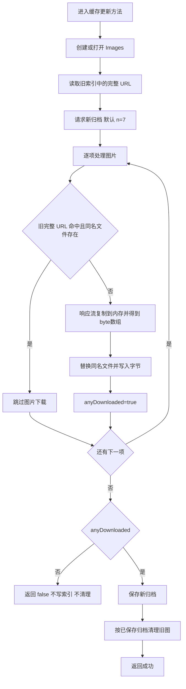

# 网络、图片下载与缓存更新编排

该模块把 Bing 的归档响应转换为本地图片集。下列角色名结合保留的类型/方法名和数据流恢复；没有声称得到应用的完整调试符号。

## NET-01：组件职责和边界

| 组件/角色 | 输入 | 输出/副作用 | 主要代码 |
|---|---|---|---|
| `BingImageDownloader` 的归档获取 | 默认 7，另有带数量入口 | 异步归档对象 | `0x1804c11e0`、`0x1804c0e20` |
| 图片字节获取 | 归档返回的相对 URL | 整张图片的 byte[] | `0x1804bfc90` |
| 请求创建/响应桥 | 完整 URL | HTTP request / response Task | `0x1804c0080`、`0x1804c00d0`、`0x1804bfe90` |
| `BingImageManager` 下载协调 | 存储接口、下载器、旧索引 | 是否至少成功下载一张；必要时写归档 | `0x1804b9f40` |
| 单张缓存协调 | 完整 URL、旧 URL 集合 | 命中则 false；下载写入后 true | `0x1804b7e10` |
| 外层缓存更新 | 下载协调器的结果 | true 后才清理旧图片 | `0x180518c60` |

这里的“接口”表示依赖角色和已见调用形态。应用存在 `IBingImageDownloader` 等保留名字，但泛型/接口分派的完整绑定没有全部恢复，不据此补写所有接口签名。

## NET-02：请求契约

归档模板固定为 `http://www.bing.com/HPImageArchive.aspx?format=js&idx=0&n={0}`。默认入口传 7；模板的格式化采用 `InvariantCulture`。请求返回后读取响应流，经 `StreamReader` 和应用的 JSON reader/deserializer 生成对象。

图片地址是 `String.Concat("http://www.bing.com", relativeUrl)`。代码没有在这条链中改写分辨率或市场；`1920x1080` 来自已保存响应 URL，不能将本地样本推广为所有可能响应的强制尺寸。响应获取异步；之后使用同步 `Stream.CopyTo(MemoryStream)`，再 `ToArray()` 返回字节数组。写盘由存储层另行完成。

后台调用同一下载器的带数量入口，但三类提供器分别传 `1`，并分别等待自己的归档响应；共享对象不等于共享响应结果。锁屏/桌面要先通过系统提供器的布尔条件及自动开关门控；前者的支持性语义是静态派生。对应调用点为磁贴 `0x1804bd952`、锁屏 `0x1804c1d80`、桌面 `0x1804be300`，详见 [后台与个性化](background-and-personalization.md)。不要把本节默认 `n=7` 描述成所有前后台路径的固定请求。

请求包装器创建 `Uri` 并检查 HTTP/HTTPS scheme，使用默认前缀工厂；响应桥通过 `TaskFactory<T>.FromAsyncImpl` 适配异步 Begin/End 调用。它不是应用直接调用 `HttpClient.GetStreamAsync` 的实现。原始模板是 HTTP；最终 HTTPS 重定向、代理、DNS、线上响应和时间开销没有观察。

## NET-03：状态顺序

这个图表达进入所恢复方法后的正常控制流。异常通过对应 async Task 传播，不包含在图中的分支会在下一节说明；它不是每次启动/后台唤醒必经此方法的证明。

## NET-04：命中和提交规则

旧完整 URL 使用 `OrdinalIgnoreCase` 比较，同名文件检查只看文件名。二者都命中才跳过。`id` 决定本地名称，但 `rf`、`pid` 等其他参数属于完整 URL，因此其他参数变化可能使相同 `id` 对应图片重新下载覆盖。

协调器串行 await 每张图片，没有已确认的应用级并发池或逐项重试。初始化及旧索引读取成功后才请求新列表；不能把“本地文件齐全”当成跳过列表请求的条件。

只有 `anyDownloaded=true` 才保存新归档；外层也只在 true 时清理。只改版权、顺序、返回旧 URL 子集等元数据变化，没有成功下载项时不会单独触发索引保存。具体文件命名、null/空集合和淘汰规则见 [数据与存储](data-model-and-storage.md) 及 [深入恢复报告](../DEEP_ANALYSIS.md)。

## NET-05：错误和一致性

| 位置 | 已见处理 | 一致性影响 |
|---|---|---|
| 无旧索引 | 转为空旧 URL 列表 | 支持首次下载 |
| 旧索引读取/解析出错 | Task 失败并传播 | 可能在网络请求前退出 |
| 第 k 张网络或写盘失败 | 终止本轮，不继续下一张 | 前面已写文件不回滚，新索引尚未保存 |
| 新索引写入失败 | 传播失败 | 不到达外层清理 |
| 清理失败 | 传播失败 | 索引已更新，旧文件可能只删一部分 |
| 全部命中 | 返回 false | 孤立文件可能暂时不清理 |

没有观察到跨图片、索引和删除的整体事务，也没有故障注入来测量实际中断后的字节状态。缓存命中不验证图片内容，因此不能保证自动修复同名坏文件。

## NET-06：地区和语言边界

列表模板无 `mkt/cc` 参数；应用在已追踪的创建到发送路径中未给 `Accept-Language` 赋值。`InvariantCulture` 格式化数字，不是 en-US 市场开关。默认 `CookieContainer=null` 分支关闭 managed cookies；对应 WinRT API 可用时底层设置 `NoCookies=1`。

Windows 底层仍可能补充最终头字段；没有目标请求捕获，不能证明线上不存在某头，也不能确定出口 IP/语言头/服务端默认规则对市场的权重。包内英文 UI、界面使用的语言和图片文件名中的市场标签不是同一层概念。启动界面语言的恢复见 [UI 与生命周期](ui-and-lifecycle.md)。

本地图片集 EN-US 与磁贴记录 ZH-CN 具有不同更新时间；这不足以证明两条客户端路径主动选择了不同市场。文件名记录的是服务端返回的图片标识。

## NET-07：主要证据

| 结论 | REA Evidence / 文件 |
|---|---|
| 默认数量 7 | `ev_5f75ca8c8a43b69dbf7cd32d4637379b1b390ab4156bef53c95dce2639a55b55`，[调用者](../evidence/rea/archive-count-caller-assembly.json) |
| 归档 URL 与 JSON 流读取 | `ev_6478a71aad1bff76fe4f8a4d997fcc5df47efdc3a25652c2138e6c8fe622593f`，[归档主体](../evidence/rea/archive-url-assembly.json) |
| 图片 URL / MemoryStream / ToArray | `ev_348c554d94d9d44272336ade5d39f5e043b7eebe3a8107dbd902272579aeb922`，[图片主体](../evidence/rea/image-url-http-assembly.json) |
| 串行协调、命中、索引条件 | `ev_e559ec21919cdf6b212f0ca080a9bd67dc539290d48532d43846200b774840eb`，[下载与存储](../evidence/deep-cache/storage-json.json) |
| 外层 true 后清理 | `ev_942fda182a00886a8532bfe6e4e76dc47d0b6ddae19c7cad395d86bd8041c909`，[外层状态机](../evidence/deep-download/refresh-cleanup-sequence.json) |
| HTTP 头、Cookie 与地区边界 | [地区完整记录](../evidence/deep-region/region-findings.json)，含 17 份 REA 分项索引 |
| 流/格式化/URI 的确切框架符号 | [符号调用点](../evidence/deep-symbols/symbols-findings.json) |
