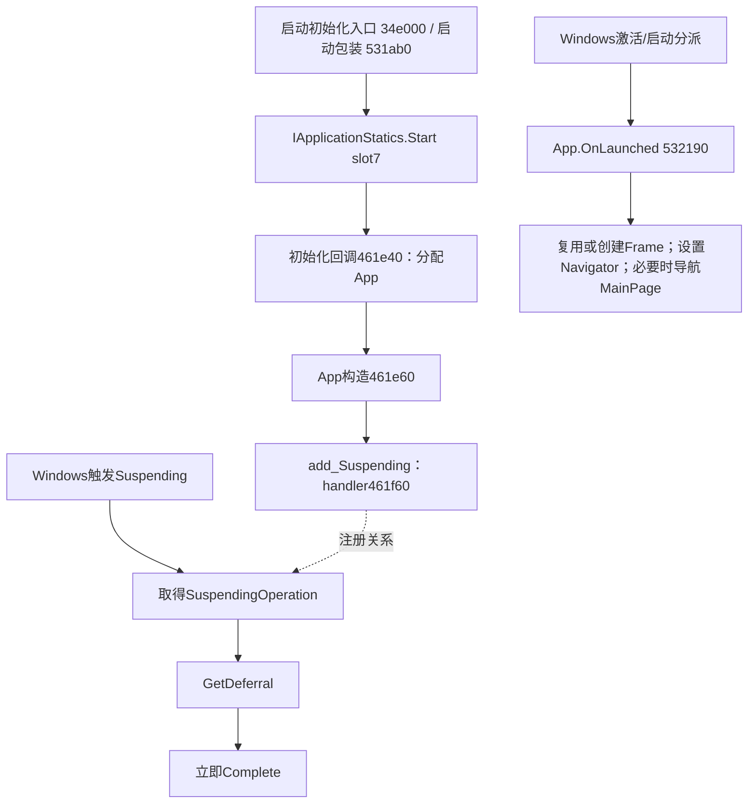

# Daily Picture：App 构造、挂起、恢复与释放边界

本篇补足原 UI 专题中“完整 App 构造、Suspending/Resuming 与释放调用者”的未解部分。最明确的新结论是：**应用确实在构造器订阅 Suspending，但处理器仅取得 deferral 后立即 Complete；该回调没有保存 UI 状态、等待下载、停止计时器或调用 Dispose。**启动入口读取 PreviousExecutionState，却没有据此恢复导航状态。应用包含显式的 App/Navigator/主 VM 释放方法，现有静态证据尚未把它们连接成自动挂起或退出清理链。

目标为本机 Daily Picture `1.4.13.0 x64` 的 `Duracellko.BingImage.Universal.dll`，SHA-256 `d9c4f3d1803ed27c3da21c1e70164423166c1460f53f0020f4ac2c68b413033a`。地址均为首选映像 VA（ImageBase=`0x180000000`），不是实时进程地址。取证只读，没有启动目标、触发挂起/恢复、改设置或写缓存。使用 REA CLI 调用本机 Cutter 目录中的 Rizin，并用该目录随附 rz-ghidra 的 SLEIGH 数据生成四份局部伪代码；配置只存在于工具进程内，没有写入工具全局配置。

“已确认”指机器码、完整函数范围、本机 WinMD 和已验证框架 PDB 支持的事实；“静态派生”表示角色或关系由多项事实恢复；“未知”保留没有连接起来的调用者或运行时行为。下文语义名不冒充主程序原始符号。机器可读结论见 [findings.json](../evidence/app-lifecycle/findings.json)，函数边界见 [functions.json](../evidence/app-lifecycle/functions.json)，原始证据和哈希见 [evidence-manifest.json](../evidence/app-lifecycle/evidence-manifest.json)。

## LIFE-01：App 类型和真正构造器已经定位

**已确认：**分配包装器 `0x180461e40` 将 EEType `0x18001af90` 传给 `RhpNewFinalizable`，随后调用 `0x180461e60`。该 EEType 的基类指针为 `0x18001b090`（Windows.UI.Xaml.Application 投影类型），四个虚槽中的第四项为此前分析的启动入口 `0x180532190`。基类相同位置的指针是 `0x1804657d0`，其完整包装器经 `IApplicationOverrides` slot7 调用 OnLaunched。

泛型桥 `0x180465800` 的 `0x180465840` 明确从泛型上下文+8 读取接收接口类型；所以 `0x18010ef38` 的第二个类型指针 `0x1800080e8` 才是 IApplicationOverrides，第一项用于参数对象转换。这里没有把两个不同用途的类型指针混为一谈。**静态派生：**上述构造、基类、覆盖槽和既有启动行为将 EEType `0x18001af90` 与 App 对象可靠联系起来，不再依赖“邻近某个字符串”的候选判断。

原 UI 专题名为 `app-constructor.json` 的旧记录实际上是 Navigator.Dispose(bool)，已在旧专题纠正；本篇 `app-constructor-real.json` 才是这次定位的 App 构造器。

REA [app-allocation](../evidence/app-lifecycle/app-allocation.json)，完整 Evidence ID：`ev_6fd03e9b8bdac1cee0953838946d4da5386a7b827142437a699bf00963748885`。

REA [base-onlaunched-projection](../evidence/app-lifecycle/base-onlaunched-projection.json)，完整 Evidence ID：`ev_c7ea8672e8f41aa29cc97cb28ec6f1dd3902e8b2e3acaf5e8d4f2dc47986b0a9`。

REA [onlaunched-interface-dispatch](../evidence/app-lifecycle/onlaunched-interface-dispatch.json)，完整 Evidence ID：`ev_e308beaad09b6a25db0575d918c826a49634db00232e7f01d3d80c86c65357ef`。

类型原字节、虚表和接口列见 [reference-candidates.json](../evidence/app-lifecycle/reference-candidates.json)；接口依据见 [abi-evidence.json](../evidence/app-lifecycle/abi-evidence.json)。

## LIFE-02：Application.Start 到 App 分配的连接

**已确认：**`0x180531ab0` 创建/复用一个目标函数为 `0x180461e40` 的委托，然后取得 Application 静态工厂并进入 `0x180461dd0`。该桥明确使用 IApplicationStatics（EEType `0x18001d308`）slot7=`Start`，传入初始化委托。另一个入口 `0x18034e000` 先执行 Mcg 初始化，再包含相同的缓存委托和 Start 调用链。

这证明 App 分配器被交给 XAML 启动契约，而不是一个孤立、未关联的分配函数。`app-start-cctor.json` 是取证时的候选文件名；它包含初始化与 Start，尚未由主程序 PDB 恢复为原始 `.cctor` 名，本文称“启动初始化入口”。未据此扩展为该 DLL 的所有宿主入口已恢复。



图表示静态连接，不表示本轮执行了这些事件。

REA [app-start-and-interfaces](../evidence/app-lifecycle/app-start-and-interfaces.json)，完整 Evidence ID：`ev_455f62b34dbe737bb05565a7cbce5646da584e1adf939f57f2347e473ba55be9`。

REA [app-start-cctor](../evidence/app-lifecycle/app-start-cctor.json)，完整 Evidence ID：`ev_83426cca2242473d189de474deb1714ace3b8bdb0ed993e71b8457ca879adf24`。

REA [application-start-projection](../evidence/app-lifecycle/application-start-projection.json)，完整 Evidence ID：`ev_9085c4f89f8264c8b0567d0a98b30cdbdad89a74209017dfe640bba479cab191`。

## LIFE-03：构造器中的真实事件订阅

**已确认：**完整构造器 `0x180461e60–0x180461f5e` 依次完成：

1. 调用 `0x1804624b0`，初始化 COM 投影并经 Application 工厂 CreateInstance 连接平台对象。该被调链的完整工厂主体已检查，内容是 COM 包装/引用管理。
2. 调用 IApplication slot10，即 RequestedTheme setter，传整数 `1`。
3. 若对象+0x60 的初始化标志为零，写为 1。独立方法 `0x180531d30` 也只执行相同标志操作；不能据这一标志推断原始 XAML 文件没有资源。
4. 建立 add/remove/handler 三个委托，并调用 WindowsRuntimeMarshal 的 AddEventHandler 分支。实际 add 目标为 `0x180462210 → 0x180462220`，remove 目标为 `0x1804620c0`，处理器为 `0x180461f60`。

`0x18046225f` 把 slot=`13` 与 IApplication 类型 `0x180007f68` 传给 ABI 桥，本机 WinMD 证实它是 **add_Suspending**；remove 包装器用 slot14=`remove_Suspending`。因此这是真实应用注册，而不是只根据 Suspending 字符串作判断。

构造器建立 remove 委托，是 WindowsRuntimeMarshal 维护事件令牌时所需的注册参数，**不表示此时正在取消订阅**。构造器中的 ManagedEventRegistrationImpl 与 NativeOrStaticEventRegistrationImpl 是互斥的适配分支，不表示注册两次。

REA [app-constructor-real](../evidence/app-lifecycle/app-constructor-real.json)，完整 Evidence ID：`ev_11c7cd42de48d8f11f696e3fb7ba27b733f3f064d817224782bae89dbd45da0e`。

REA [application-event-projections](../evidence/app-lifecycle/application-event-projections.json)，完整 Evidence ID：`ev_e6619ac275b45bfd79a802c4eb21843e27b9de923b34bdd32ae0dfec4ffe786e`。

REA [app-constructor-pseudocode](../evidence/app-lifecycle/app-constructor-pseudocode.json)，完整 Evidence ID：`ev_f5f9c330c2087bfa6406e046011719907eb48f399b9645f6a70d7cb3cf93c888`。

## LIFE-04：Suspending 的完整行为是立即完成 deferral

**已确认：**处理器 `0x180461f60–0x180461fb6` 共 86 字节。它接收第三个参数中的事件对象，然后只有三个调用，接口、上下文和槽位如下：

| 指令位置 | 上下文 | WinMD 接口与方法 |
|---|---|---|
| `0x180461f7b` | `0x18010ed70` | ISuspendingEventArgs.get_SuspendingOperation，slot6 |
| `0x180461f93` | `0x18010ed88` | ISuspendingOperation.GetDeferral，slot6 |
| `0x180461fab` | `0x18010eda0` | ISuspendingDeferral.Complete，slot6 |

等价的语义伪代码为：

```text
OnSuspending(sender, args):
    operation = args.SuspendingOperation
    deferral = operation.GetDeferral()
    deferral.Complete()
```

完整已解正常路径没有读取 App 的 Navigator 字段，没有调用文件/设置保存、图像服务、VM、计时器、Dispose、异步 builder 或任务等待，也没有保存、Stop 或恢复分支。可以确认**这个挂起回调的已解正常路径没有自定义保存工作**，而非仅说“未找到保存字符串”。本轮未完整解析托管 EH 表，不能仅凭正常指令路径或 PE unwind 标志排除所有托管异常处理；若平台调用抛错，是否存在其它处理器、具体异常类型和 OS 对失败的处理仍未知。

这与后台磁贴任务的 deferral 不同：本篇是 `ISuspendingDeferral`，后台专题为 `IBackgroundTaskDeferral`；二者接口 IID、入口及生命期各自独立。

REA [app-constructor-real](../evidence/app-lifecycle/app-constructor-real.json)，完整 Evidence ID：`ev_11c7cd42de48d8f11f696e3fb7ba27b733f3f064d817224782bae89dbd45da0e`。

REA [suspending-pseudocode](../evidence/app-lifecycle/suspending-pseudocode.json)，完整 Evidence ID：`ev_d62b720c827f1e47f24da08df5dcc165561bb9d95f910c3412f3006cfe3b081c`。

三个 IID 及 WinMD 方法顺序保存在 [system-winmd.json](../evidence/app-lifecycle/system-winmd.json) 和 [abi-evidence.json](../evidence/app-lifecycle/abi-evidence.json)。

## LIFE-05：Resuming、LeavingBackground、EnteredBackground 的证据边界

**已确认：**安装 DLL 确实包含这些框架事件的投影函数。它们由 WinMD 的接口类型与数值 slot 直接识别：

| 事件 | add 包装/主体 | remove 包装 | 外部契约 |
|---|---|---|---|
| Suspending | `0x180462210 / 0x180462220` | `0x1804620c0` | IApplication slots13/14；已证明 App 构造调用 |
| Resuming | `0x18051e4e0` | `0x18051e4b0` | IApplication slots15/16 |
| LeavingBackground | `0x18051e270 / 0x18051e280` | `0x18051e240` | IApplication2 slots10/11 |
| EnteredBackground | `0x18051e340 / 0x18051e350` | `0x18051e310` | IApplication2 slots12/13 |
| UnhandledException | `0x18051e410 / 0x18051e420` | `0x18051e3e0` | IApplication slots11/12 |

**已确认的范围性否定：**完整 App 构造器、其 Application 构造工厂和完整 OnLaunched 中，没有登记表中其余四类事件。完整 Suspending handler 也没有继续安装它们。对这些投影入口做全映像 E8/E9 与常见 RIP 相对引用的候选扫描，只看到几个 add 外壳进入相邻主体，没有应用处理器构造/注册调用链。另一方面，数据区仍可含投影地址或元数据索引，不能把投影代码删减为“事件不存在”。

**未知：**尚未完整恢复所有托管接口分派、反射和数据驱动调用，因此不能由候选扫描无调用者升级为“程序任何路径都不可能注册 Resuming/EnteredBackground”。目前可靠结论是：**已经恢复的 App 生命周期初始化只证实 Suspending 这一项应用订阅；另外四项只证实框架 API 支持，没有证实应用自定义处理器。**

REA [lifecycle-event-accessors](../evidence/app-lifecycle/lifecycle-event-accessors.json)，完整 Evidence ID：`ev_0770b88bee78dd34926e473776098a0a11c36de70fc1a6372c9fc15f3d771853`。

完整候选扫描范围与命中见 [reference-candidates.json](../evidence/app-lifecycle/reference-candidates.json)；扫描脚本 [app_lifecycle_references.py](../scripts/app_lifecycle_references.py) 明确保留 byte-pattern 限制。

## LIFE-06：启动会读取执行状态，却不据此恢复导航

**已确认：**App.OnLaunched `0x180532190` 在 Window.Content 为 Frame 时走复用分支；否则创建 Frame、设置 UI Language、安装导航事件并创建 Navigator，存到 App+0x58。这是对仍在当前对象图中的 Frame 的复用，不能称作跨进程恢复。

在新 Frame 路径，`0x180532438` 将栈中的输出值清零，`0x180532445–0x180532455` 以 IActivatedEventArgs（`0x18000e498`）slot7 读取 **PreviousExecutionState**。随后直接取得窗口并写 Content；直到函数结束都没有比较/使用该输出值决定恢复。该状态读取因此不足以证明处理过 Terminated 状态。

Frame.Content 为空时，从 launch args 取 Arguments，交给 Navigator 导航 MainPage；非空则保留内容。最后 Window.Activate。完整入口没有 Frame.GetNavigationState/SetNavigationState 调用，也没有读取所保存的 SelectedIndex、导航栈或未完成操作来恢复 UI。现有归档/图片缓存的读取属于页面和数据层的正常初始化，见 [ui-and-lifecycle.md](ui-and-lifecycle.md) 与 [data-model-and-storage.md](data-model-and-storage.md)，不等价于完整 UI 会话序列化。

**静态派生：**在已覆盖的挂起与启动主链中，挂起没有自定义状态保存，启动没有基于 PreviousExecutionState 的自定义导航恢复。框架/系统本身如何保留对象和进程，及其他未解入口，仍需与此区分。

REA [app-lifecycle-candidate](../evidence/architecture-ui/app-lifecycle-candidate.json)，完整 Evidence ID：`ev_ec4ca01bd51f99b16983649e566c60e119d609e71611ae86e05593e3cb9324b2`。

REA [onlaunched-pseudocode](../evidence/app-lifecycle/onlaunched-pseudocode.json)，完整 Evidence ID：`ev_c81b8372c8bd30ebcbd24e56eaa61afe0c5fb63ebee383b0847908a1c62c2795`。

## LIFE-07：App 的显式释放会处理 Navigator，但自动调用者未建立

**已确认：**`0x180531f50` 读取 App+0x58；非空时尝试转成 IDisposable，转换成功就经 dispatch cell `0x180308890` 调用，再将字段清零。相邻 `0x180531dc0` 是接受 Boolean 的同类清理主体，只有传入 true 时执行字段释放。App 启动在 `0x180532427–0x18053242e` 保存的恰是 Navigator 对象，所以被清理的是 Navigator，而非直接释放整个 VM/图片集合。

App 类型的接口列含 imported-tag 指针 `0x1802a6749`；解引用 import `0x1802a6748` 经精确框架 PDB 定位为 System.IDisposable。App 的相对方法表中有指向 `0x180531f50` 的项。由这些事实及行为，把该入口命名为 **App.Dispose 语义**，置信度高；完整托管 dispatch map 仍未作为本篇前提。

**重要的调用边界：**对 `0x180531f50` / `0x180531dc0` 的定向代码引用扫描没有建立普通直接调用或委托注册来源。已恢复构造、OnLaunched、OnSuspending 没有调用它。方法表存在只证明它可被间接分派，不能证明 OS 关闭窗口或挂起时会自动调用 IDisposable。故本篇没有画出“退出→App.Dispose”的实线连接。

REA [app-nearby](../evidence/app-lifecycle/app-nearby.json)，完整 Evidence ID：`ev_6dfb89df91968c1ff858cb3bd985aeae45a7c2cc07096b251cdad77e5c021640`。

REA [app-dispose-pseudocode](../evidence/app-lifecycle/app-dispose-pseudocode.json)，完整 Evidence ID：`ev_f11a85900dc99e99071efbcd09721996b63095229acd74bc0916d6deabf78e02`。

类型表及 PDB import 对照见 [reference-candidates.json](../evidence/app-lifecycle/reference-candidates.json)。

## LIFE-08：SuppressFinalize 的参数存在一处不寻常事实

**已确认：**在 `0x180531f88–0x180531f9c`，App.Dispose 语义入口加载 import `0x1802a6380`、创建一个对象，将其+8 写为 0，然后把**新对象**传给 import `0x1802a27d8`。精确 SharedLibrary PDB 分别把这两个 import 标为 `Boxed_Boolean` 和 `System.GC.SuppressFinalize`；Cutter 伪代码与寄存器数据流一致。

因此这个调用的参数语义是装箱的 false，并非 App this。不能据该调用断言 App 自身的终结已被抑制。这里仅记录静态实现事实，没有将它扩大为已经观察到的内存泄漏、崩溃或退出故障。

此外，App 分配使用 RhpNewFinalizable，类型尾部保存了 `0x180531d80` 这一方法指针。该短方法及其异常清理 funclet 只转发到一个大量代码折叠别名共用的框架 import，没有访问 App+0x58，也没有进入上述 Navigator 清理。将其视为终结相关候选是布局派生；框架折叠 import 的任一名称都不能冒充 App 原始析构函数名。自动释放效果仍未知。

REA [app-nearby](../evidence/app-lifecycle/app-nearby.json)，完整 Evidence ID：`ev_6dfb89df91968c1ff858cb3bd985aeae45a7c2cc07096b251cdad77e5c021640`。

REA [app-dispose-pseudocode](../evidence/app-lifecycle/app-dispose-pseudocode.json)，完整 Evidence ID：`ev_f11a85900dc99e99071efbcd09721996b63095229acd74bc0916d6deabf78e02`。

## LIFE-09：Navigator.Dispose 不等于主 VM.Dispose

**已确认：**Navigator 的 public Dispose 语义入口 `0x180531e60` 传 true 调用 `0x180531e90`，随后 `GC.SuppressFinalize(this)`。与 App 上一条不同，这里使用的是原 Navigator 对象。布尔清理体检查 disposed 标志；需要清理时取消 Frame.Navigated 上的 `0x1804a9930`，然后写 disposed 标志。

该完整清理体没有读取 Frame.Content.DataContext、没有遍历页面/VM、没有调用主 VM 的计时器释放入口，也没有撤销 App 另行登记的 Frame.Navigated 或 NavigationFailed 委托。由 App.Dispose→Navigator.Dispose 的高置信语义链，不能继续推导出所有页面 ViewModel 已释放。

另外，Navigator 转发导航的虚方法 `0x1804a1c30` 只读 Frame.CanGoBack，设置 SystemNavigationManager.AppViewBackButtonVisibility；其完整函数不读取旧页面/DataContext，也没有释放旧 VM。此项由并行计时器调查交叉确认。

REA [app-nearby](../evidence/app-lifecycle/app-nearby.json)，完整 Evidence ID：`ev_6dfb89df91968c1ff858cb3bd985aeae45a7c2cc07096b251cdad77e5c021640`。

REA [app-constructor](../evidence/architecture-ui/app-constructor.json)，完整 Evidence ID：`ev_bda048b4579340be4b5293ade7fd5e18a9436c60c289904e23e1dcdf18c68016`。

REA [navigator-forwarded-event](../evidence/timer-cleanup/navigator-forwarded-event.json)，完整 Evidence ID：`ev_9465589a2edf5c364ee2f4fc2ff5f03f64bd78a641be45a1ac09329117842ba5`。

## LIFE-10：主 VM 的释放方法存在，但不在已证实的挂起链上

**已确认：**`0x180531e10` 对 this+0x30 和 this+0x38 两只 DispatcherTimer 分别调用 Stop（IDispatcherTimer slot12），再执行 GC.SuppressFinalize(this)。完整方法没有取消 Tick 订阅或将两个字段清空。它与主 VM 的类型/方法表对应关系由计时器专题补证；本文用它划清与 App 挂起处理器的调用边界。

**已确认：**本篇的 Suspending 函数不访问主 VM；App 清理处理的是 Navigator；已恢复的 Navigator.Dispose 和导航转发也没有连到该主 VM 清理。**未知：**其他间接调用、页面退出行为以及对象实际 GC 可达性尚不能由这些方法存在与否决定。不能把 “有双 Stop 方法” 写成“挂起必定停止前台计时器”，也不能因未找到调用就直接判定计时器必然泄漏。

REA [app-nearby](../evidence/app-lifecycle/app-nearby.json)，完整 Evidence ID：`ev_6dfb89df91968c1ff858cb3bd985aeae45a7c2cc07096b251cdad77e5c021640`。

## LIFE-11：结论范围、复查与剩余问题

本篇已由完整函数和接口合同解决：App 的真实构造入口；唯一已证实的生命周期订阅 Suspending；deferral 立即完成；启动 PreviousExecutionState 读后未分支；App/Navigator/主 VM 各自释放体的责任与未连接边界。余下问题是**谁在运行时调用显式释放入口**、未解间接分派和其他激活路径、平台进程保留/终止策略，以及事件与 GC 实际效果。本篇不再把“App 挂起回调做了什么”整体标为未知，但不声称已恢复所有退出与恢复路径。

取证方法可复用：

- [app_lifecycle_inspect.py](../scripts/app_lifecycle_inspect.py)：按限定地址和长度执行 REA `pDj`，保存完整 JSON 与带 import 注释的汇编。
- [app_lifecycle_pseudocode.py](../scripts/app_lifecycle_pseudocode.py)：只对指定 `.pdata` 起点执行进程内 `af`/`pdg`，设置本地 Cutter 的 SLEIGH 目录；伪代码不替代机器码/ABI证据。
- [app_lifecycle_winmd.ps1](../scripts/app_lifecycle_winmd.ps1)、[app_lifecycle_abi.py](../scripts/app_lifecycle_abi.py)：本机 WinMD 的 PEReader 元数据读取、IID/slot/目标类型对照；不加载目标代码。
- [app_lifecycle_references.py](../scripts/app_lifecycle_references.py)：限定目标的全映像字节引用候选；范围、算法和不能证明全调用图的限制均保留。
- [app_lifecycle_validate.py](../scripts/app_lifecycle_validate.py)：目标 SHA、指令原字节、完整/未改动/未截断标志、函数起点、证据 ID 和文档链接复查。

所有新分析范围从已知 `.pdata` 起点开始；连续范围可能在最后一个附带 helper 中途结束，本篇函数表只引用完整包含的函数。命令 completion=complete 只说明请求完成。REA 记录原样保留，不能将反汇编范围的尾部部分函数当作完整否定证据。局部辅助脚本与机器可读成果不具有独立 REA ID；它们明确引用原始 REA 和目标 SHA。
