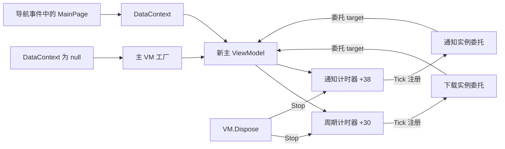

# Daily Picture：前台计时器、Dispose 与页面生命周期

本篇补足两只前台 `DispatcherTimer` 的清理与对象生存期。**主 ViewModel 的 Dispose 已经找到并关联到类型：它依次 Stop 周期刷新计时器、Stop 通知计时器，再调用 `GC.SuppressFinalize(this)`。这段实现没有解绑 Tick、清空字段、设置 disposed 标志或取消异步工作。已恢复的导航、挂起和图片 Unloaded 路径尚未连接到这个 Dispose。**因此，“存在清理方法”是已证事实，“离开页面自动清理”仍没有成立的调用链。

目标为安装版本 `1.4.13.0 x64` 的 `Duracellko.BingImage.Universal.dll`，路径为 `C:\Program Files\WindowsApps\14403Duracellko.NET.BingImageoftheDay_1.4.13.0_x64__1wy5t1va6xay4\Duracellko.BingImage.Universal.dll`，SHA-256 为 `d9c4f3d1803ed27c3da21c1e70164423166c1460f53f0020f4ac2c68b413033a`。地址均为首选映像 VA，基址 `0x180000000`，不代表现场 ASLR 地址。本轮只读安装文件与本机 WinMD；没有运行应用、触发导航或挂起、修改设置/缓存，也没有采集进程堆和 GC roots。

“已确认”表示直接机器码、类型指针、匹配的框架 PDB 或本机 WinMD 支持；“静态派生”表示这些事实组合后的角色或条件结论；“未知”保留未连接的调用者和运行时行为。主程序原始 PDB 不可得，本文的主 VM、工厂和 Dispose(bool) 等名称是恢复的语义名。机器可读条目见 [findings.json](../evidence/timer-cleanup/findings.json)、[functions.json](../evidence/timer-cleanup/functions.json)，完整证据和哈希见 [evidence-manifest.json](../evidence/timer-cleanup/evidence-manifest.json)。

## TIMER-01：每个新主 VM 建立独立的一对计时器

主 VM 工厂 `0x1804a20e0` 分配依赖对象，随后以 EEType `0x18001c678` 分配 VM，并在 `0x1804a22a5` 调用构造函数 `0x1804a22c0`。构造把两只 `DispatcherTimer` 保存在以下字段：

| 字段 | Interval 的直接依据 | Tick 入口 | 何时 Start |
|---|---|---|---|
| VM `+0x30` | 地址 `0x180144548` 的 double `1.0`，经 `TimeSpan.FromHours` | `0x180602cc0` 跳板 → `0x1804a4680` → DownloadImages | 构造末尾 |
| VM `+0x38` | 地址 `0x180144540` 的 double `5.0`，经 `TimeSpan.FromSeconds` | `0x1804a3910` | 通知显示函数接收非空、非空串消息时 |

这里是两只实际分配的计时器，而不是一个计时器切换两种时长。它们分别属于构造的 VM 实例；没有在此工厂发现全局共享计时器或复用已有 VM 的分支。构造也会启动 LoadImages 和 DownloadImages，二者的异步入口不由本构造串行等待。

这些时长只证明配置值，不能保证 UI 阻塞时、挂起期间或关闭后仍按这一频率执行。尤其 **一小时前台 Tick 不是后台任务的触发间隔**。后台调度与系统个性化处理见 [后台专题](background-and-personalization.md)。

来源：[构造完整机器码](../evidence/architecture-ui/mainvm-constructor.json)，`ev_b935c2021cb366198b42f33074e5afebf0cec6e15c9eb31b98e4fd8fb5df33d2`；[VM 工厂](../evidence/architecture-ui/viewmodel-factory.json)，`ev_f63b5d05cdcc8d83acf39dffd39d44f6549c26bb5bc17bf5f52737d4907fcfb1`；[周期 Tick 跳板](../evidence/architecture-ui/timer-download-thunk.json)，`ev_4cff0cacc642098971aabefc46ded9ce0ee85dcb820f637671d2a5a2126b726d`。

## TIMER-02：Tick 捕获 VM，移除委托是注册参数

构造不是安装两个无目标的静态回调：

- 通知 Tick：`0x1804a27dd` 取处理器 `0x1804a3910`，`0x1804a27e4` 把 `r14=this VM` 放入委托目标参数。
- 周期 Tick：`0x1804a28c1` 取跳板 `0x180602cc0`，`0x1804a28c8` 同样把 VM 放入目标参数。

这是绑定实例的委托。VM 持有计时器字段，Tick 委托又以 VM 为目标，构成需要关注的引用关系；实际 GC 根、WinRT 事件适配层的存活规则以及对象何时回收，仍需要运行时证据。**单凭引用环不能确认泄漏。**

`0x1804a38e0` 与 `0x1804a38b0` 分别桥接 `IDispatcherTimer.add_Tick` 和 `remove_Tick`。本机 `Windows.UI.Xaml.winmd` 的 IID `d160ce46-cd22-4f5f-8c97-40e61da3e2dc` 与目标内类型 `0x1800084e0` 匹配；槽 9/10 是事件增删，槽 11/12 是 Start/Stop。三个相关上下文为 `0x18010f148`、`0x18010f138`、`0x18010f128`。

关键区别是：目前找到的 `remove_Tick` 包装器代码引用仅为构造内 `0x1804a27ba` 与 `0x1804a289e`。它们建立绑定计时器对象的 `Action<EventRegistrationToken>`，与 add 回调和 Tick 处理器一起传给 `WindowsRuntimeMarshal.*.AddEventHandler`。**建立 remove 委托不是执行 `Tick -=`。**Managed/NativeOrStatic 两个注册适配分支也不是各注册一次。

在已确认的 Dispose 主体中没有这个移除包装器的调用，也没有应用级 RemoveEventHandler 调用。框架注册层仍可能在其内部或错误处理时使用传入的移除回调，本篇不声称它永远不会执行。

证据：[事件包装器和通知 Tick](../evidence/architecture-ui/mainvm-selection-navigation.json)，`ev_6c990d88120eed1a8a55b347f36aae7c2edc4c4e56fc1677797ac35539b06384`；[匹配 PDB 的委托、AddEventHandler、接口类型符号](../evidence/timer-cleanup/interface-event-symbols.json)；[类型和 ABI 原字节](../evidence/timer-cleanup/type-and-abi-evidence.json)；[限定编码的全镜像引用索引](../evidence/timer-cleanup/reference-inventory.json)。

## TIMER-03：主 VM 的 IDisposable 实现与实际清理顺序

完整函数 `0x180531e10–0x180531e5e` 为 78 字节。用完整 `pDj`、恢复可用的 rz-ghidra `pdg`、WinRT 槽位和匹配的 SharedLibrary PDB 交叉确认后，其语义可以写为：

```csharp
// 语义复原；不是恢复出的原始源码。
void Dispose()
{
    periodicTimer.Stop();       // this + 0x30；call 0x180531e33
    notificationTimer.Stop();   // this + 0x38；call 0x180531e48
    GC.SuppressFinalize(this);  // call [0x1802a27d8] at 0x180531e50
}
```

这不是仅根据相邻代码位置猜测它属于主 VM：

1. 工厂分配的 EEType 是 `0x18001c678`，其接口表包含间接类型导入 `0x1802a5150` 的 `INotifyPropertyChanged` 和 `0x1802a6748` 的 `IDisposable`；这两个导入由匹配框架 PDB 确认。
2. 该类型 `+0x48` 字段 `0x18001c6c0` 的相对值 `78ffffff` 指向 `0x18001c638`。
3. `0x18001c638` 的相对值 `d8575100` 指向 `.pdata` 函数起点 `0x180531e10`，其双计时器字段与构造一致。

本类型的 `+0x40` 实际是 `0x18014cf28`，不能套用其它类型的“+0x40 相对方法表”经验。早期 [reference-inventory.json](../evidence/timer-cleanup/reference-inventory.json) 保留了那个未证候选，最终依据是 [type-and-abi-evidence.json](../evidence/timer-cleanup/type-and-abi-evidence.json) 中经过字段计数与目标边界验证的 `+0x48` 链。没有将这一局部结果泛化成完整 .NET Native 类型/分派表解析器。

Dispose 的具体限制同样直接可见：没有读取/写入 disposed 标志，没有解绑 Tick，没有置空 `+0x30/+0x38`，没有清空 `NotificationMessage`，没有取消在途异步操作，也没有释放 VM 的服务、命令或图片集合。两次 Stop 使用 WinRT 槽 12；没有另外调用两只计时器对象的 IDisposable。

已解的正常指令路径是顺序执行两次 Stop，再调用 SuppressFinalize；本轮未建立异常发生后仍保证后续清理的本地 EH 路径。PE unwind flags 为 0 是原始记录中的观察，但 .NET Native 托管 EH 元数据尚未完整解析，不能仅据这一旗标排除所有处理器。因此，若前一次 Stop 抛出，后续步骤不受当前已证正常路径保证；异常后的实际控制转移仍保留为未解边界。该方法未设重复调用守卫，因此再次调用会再次尝试两次 Stop；不能仅据本体断言底层调用对重复操作的所有异常行为。

来源：[精确 78 字节指令](../evidence/timer-cleanup/mainvm-dispose-instructions.json)，`ev_163276c9187267392694be367c0056754df21598e908fd1caf8df54ad55efcc9`；[完整 REA 伪代码](../evidence/timer-cleanup/mainvm-dispose-pseudocode.json)，`ev_4b3a75a54721e188696dc5565892ba461d544fb32bda381682d6d3eac38bb00c`；[GC.SuppressFinalize 精确框架符号](../evidence/timer-cleanup/suppress-finalize-symbol.json)。

## TIMER-04：还有一份带 bool 参数的双 Stop 本体

`0x18053eb80–0x18053ebc6` 先检查 `dl`，为 false 直接返回，为 true 执行相同的两次 Stop：

```csharp
// 行为确定；原始名称与可见性尚未由主程序符号恢复。
void DisposeLike(bool disposing)
{
    if (!disposing) return;
    periodicTimer.Stop();
    notificationTimer.Stop();
}
```

它与主 VM 的字段、上下文和清理形状一致，语义上高度支持 `Dispose(bool)` 辅助方法。它不调用 SuppressFinalize。公开 Dispose 本体直接展开两次 Stop，**本轮没有找到它对这份 bool 方法的直接调用**，也没有据相同代码声称已经证明原始 C# 的内联关系、访问级别或 finalizer 链。

来源：[70 字节完整机器码](../evidence/timer-cleanup/timer-second-operation.json)，`ev_7cb1d94d02794e42c9c65655a5536184cae35f22a2cead4f8f848b43a577b544`；[代码与元数据引用索引](../evidence/timer-cleanup/dispose-reference-inventory.json)。

## TIMER-05：调用者检查的实际覆盖范围

本轮没有停在“找不到直接 xref”。检查包括代码中的选定指令编码、非执行段中的相对/绝对指针、类型接口和候选 IDisposable 分派单元，并把候选调用的接收对象追回来源。

| 检查层 | 已得结果 | 不能推出的结论 |
|---|---|---|
| 全镜像可执行节的 E8/E9、REX RIP lea/mov、FF15/FF25 模式 | 没有对 `0x180531e10` 或 `0x18053eb80` 的匹配代码引用 | 不能说它们未使用、是死代码或永远不执行 |
| 非执行节的 relative32、RVA32、absolute64 | 找到主 VM 相对方法表及元数据中的方法 RVA；`.pdata` 自身条目单独保留 | 不能把元数据指针当实际执行调用者 |
| 计时器 Start/Stop 上下文 `0x18010f128` | 匹配且由完整函数核对的使用函数为构造、通知显示、通知 Tick、公开 Dispose、bool 清理 helper 五处 | 不能排除其它未枚举编码、生成模式或框架运行时行为 |
| 指向导入 IDisposable 的 tagged 分派单元 | 全镜像匹配 544 个候选单元；进一步检查应用/UI 相关区段的 8 处引用 | 不能把 544 个通用 IDisposable 候选当主 VM 的释放路径 |

8 处引用的实际对象如下。代码区段的限定是 `[0x1804a0000, 0x1804ab000)` 和 `[0x180531000, 0x180532500)`；其它区段的候选没有被假装逐一完成对象溯源。

| 分派单元 | 代码引用 | 已恢复的接收对象 |
|---|---|---|
| `0x180304900` / `0x180304910` | `0x1804a1009` / `0x1804a102a` | 旧后台任务名称集合的枚举器及其异常清理 |
| `0x180304960` / `0x180304970` | `0x1804a347c` / `0x1804a354d` | LoadImages 中图片记录集合的枚举器及其异常清理 |
| `0x180304bc0` / `0x180304bd0` | `0x1804a8caa` / `0x1804a8cfa` | 图片项 LoadImage 获得的流及其异常清理 |
| `0x180308880` / `0x180308890` | `0x180531dea` / `0x180531f76` | App 字段 `+0x58` 保存的 Navigator |

这些是其它对象的 Dispose。特别是“图片流用完后释放”和“页面 ViewModel 被释放”属于不同生命周期，不能用前者补全后者。

来源：[调用点分类及逐条 REA 引用](../evidence/timer-cleanup/callsite-classification.json)、[分派单元与指针原记录](../evidence/timer-cleanup/dispose-reference-inventory.json)、[计时器特定引用](../evidence/timer-cleanup/reference-inventory.json)。新补的枚举器异常清理为 [unregister-enumerator-cleanup.json](../evidence/timer-cleanup/unregister-enumerator-cleanup.json)，`ev_7526e44bc07292194bcec99d4c94d5daea3eb2b7e2aebbe4fb20eacf039f943b`。

## TIMER-06：导航、挂起和 Unloaded 没有连成主 VM 释放链

Navigator.Frame.Navigated `0x1804a9930` 读取**导航事件的新 Content**，转换为 FrameworkElement；其 `DataContext == null` 时调用 VM 工厂并设置 DataContext，非 null 时跳过。接着把 Content、NavigationMode、Parameter 组成参数对象，在 `0x1804a9a4c` 通过虚槽 `+0x40` 转发。

本轮补上了转发后的实际目标：Navigator EEType `0x18001bd50` 的这个槽为 `0x1804a1c30`。其完整 124 字节函数只做：

```csharp
void OnNavigated(/* 传入的导航包装对象未被此实现使用 */)
{
    var manager = SystemNavigationManager.GetForCurrentView();
    manager.AppViewBackButtonVisibility = frame.CanGoBack
        ? AppViewBackButtonVisibility.Visible   // 0
        : AppViewBackButtonVisibility.Collapsed; // 1
}
```

这里没有获取旧页面、没有读取旧 DataContext，也没有 Stop 或 VM Dispose。接口对应关系由本机 `Windows.UI.winmd` 新补齐：`0x18010f100` → ISystemNavigationManagerStatics.slot6=`GetForCurrentView`；`0x18010f118` → **ISystemNavigationManager2**.slot7=`put_AppViewBackButtonVisibility`。它们不是同一个接口。`IFrame` slot8=`get_CanGoBack` 和 Visible/Collapsed 的整数值也已核实。

相关生命周期路径的证据层级为：

| 路径 | 静态已确认的行为 | 主 VM 清理是否连上 |
|---|---|---|
| Navigator.Frame.Navigated → 具体覆盖方法 | 按需为新页面创建 VM；随后更新返回按钮显隐 | 未连上；完整两段不释放旧 VM |
| Navigator.Dispose(bool) `0x180531e90` | 取消自己在 Frame.Navigated 的订阅并设自身 disposed 标志 | 此函数不取页面 VM，也不停止两只计时器 |
| App Dispose `0x180531f50` / helper `0x180531dc0` | 对 App `+0x58` 中的 Navigator 执行 IDisposable 并清字段 | 所持对象是 Navigator；主 VM 没有被该字段直接释放 |
| App.Suspending `0x180461f60` | GetDeferral 后立即 Complete | 处理器没有 Stop/Dispose，也没有等待下载 |
| 图片控件 Image.Unloaded `0x1804c86e0` | 从 Image.Tag 取令牌，取消 SourceProperty 变化回调 | 没有主 VM Dispose、取消下载或清空图片源 |

App Dispose 是否被系统退出链自动调用，同样尚未由实际调用者证明，不能把“App 含 Dispose”转写为“退出时保证清理”。图片控件 Unloaded 也不是 MainPage 离开的同义事件。本篇未完整证明所有框架回收、页面缓存或虚拟化策略。

来源：[Frame.Navigated](../evidence/architecture-ui/frame-on-navigated.json)，`ev_09badf7ad47e420a19444bc524803965e86ea0059cdcf465f03cb81fd358ada1`；[具体导航覆盖方法](../evidence/timer-cleanup/navigator-forwarded-event.json)，`ev_9465589a2edf5c364ee2f4fc2ff5f03f64bd78a641be45a1ac09329117842ba5`；[新 WinMD 原记录](../evidence/timer-cleanup/system-navigation-winmd.json)与[目标类型/ABI 配对](../evidence/timer-cleanup/type-and-abi-evidence.json)。Navigator 释放见 [旧名 app-constructor.json](../evidence/architecture-ui/app-constructor.json)，`ev_bda048b4579340be4b5293ade7fd5e18a9436c60c289904e23e1dcdf18c68016`；App 和挂起调用证据见 [App 生命周期专题](suspend-and-resume.md)；Image.Unloaded 为 [完整处理器](../evidence/image-lifetime/image-unloaded-handler.json)，`ev_9fb1a0e8c14d142beb292ee27bad1e3b2dfbe6fcee70df050adb64521f25420d`，详见 [图片加载与生存期](image-loading-and-lifetime.md)。

## TIMER-07：Stop 当前计时器不等于终止 VM 的所有工作

通知函数 `0x1804a2e90` 的主要顺序是：旧消息不为 null 时清空并发属性通知；Stop 通知计时器；新字符串通过 `String.IsNullOrEmpty` 检查后，写入消息并 Start 通知计时器。通知 Tick `0x1804a3910` 则 Stop 自身，再清空消息并发属性通知。

```csharp
void ShowNotification(string message)
{
    if (NotificationMessage != null) {
        NotificationMessage = null;
        RaisePropertyChanged("NotificationMessage");
    }
    notificationTimer.Stop();
    if (!String.IsNullOrEmpty(message)) {
        SetNotificationMessage(message);
        notificationTimer.Start();
    }
}
```

该函数不检查 disposed 状态；Dispose 自身也没有设置这种状态。因此可以作以下**条件推导**：如果在 Dispose 之后仍有持有 VM 的调用者或在途异步完成分支进入 ShowNotification，非空消息会重新启动通知计时器。已有到该函数的异步路径包括下载错误消息、保存成功消息以及桌面/锁屏设置成功消息。没有证据显示本轮真的发生过这种顺序，也没有据此报告实际竞态或泄漏。

周期 Tick 直接进入刷新执行入口 `0x1804a4680`，继而进入 DownloadImages，没有先经过 RefreshCommand.CanExecute。下载状态机 `0x1804a2b50` 自身检查内部“正在下载”标志；它提供下载重入门控，不能代替 disposed 检查。Dispose 中没有取消这些已经开始的异步操作。对已经排入 Dispatcher 队列但尚未执行的 Tick，平台会如何处理，仍是未实测的系统边界。

来源：[通知显示函数](../evidence/architecture-ui/mainvm-property-and-refresh.json)，`ev_937c8d79fee30a39d849d4b17e2de267ee75c422a55ae353bf2e451fba332cd9`；[通知 Tick](../evidence/architecture-ui/mainvm-selection-navigation.json)；[下载状态机](../evidence/architecture-ui/download-state-and-handlers.json)，`ev_6e2e44448eb75f94fa8ab47b9c42f374f0816f81e48ecff693e7dc11c397e1b5`。其它异步通知调用点分别在 [保存](../evidence/architecture-ui/save-command-state.json)、[桌面](../evidence/architecture-ui/personalization-command-flow.json)和[锁屏](../evidence/architecture-ui/lockscreen-command-flow.json)的完整函数中。

## TIMER-08：多实例风险与仍需运行时证明的边界

已确认的静态对象关系如下。图中的“注册”是代码中的事件连接，不表示本轮测到的 GC 根。



每次确实进入主 VM 工厂都会创建一个新 VM 和一对计时器；同一个已有非 null DataContext 的页面则绕过该创建分支。因此，如果多个不同页面对象都满足创建条件，代码允许多组独立实例。这个结论依赖条件，**不等于每次从设置页返回必定创建新 VM**。

还未闭合的范围是：

1. 主 VM 的 IDisposable 在真实应用中由谁、何时调用；还有哪些元数据或框架分派会触及它。
2. `Frame.CacheSize`、`NavigationCacheMode` 和返回导航的实际页面复用情况；旧页面、VM、事件委托的实际 GC 可达性。
3. 是否实测存在重复周期刷新、回调在 Dispose 后执行、通知计时器重新启动或对象长期存活。
4. 系统挂起/恢复、UI 线程忙碌期间的实际 Tick 时间、次数和已排队事件行为。

在这些证据出现前，合适的描述是“清理实现有限，自动调用链未证，存在有条件的重新启动/多实例可能性”。不将它提升为已确认泄漏，也不将系统暂停调度误写成应用主动 Stop。

## 复核与复现

本专题的新 REA JSON 完整保存，不裁掉 stdout、参数或 Evidence ID。Cutter 随附的 Rizin 和 rz-ghidra 使用进程内命令 `e ghidra.sleighhome=E:/Softwares/Cutter-v2.5.0-Windows-x86_64/lib/rizin/plugins/rz_ghidra_sleigh`，再执行单函数 `af` / `pdg`；没有安装新工具、写全局配置或执行目标代码。伪代码只作辅助，主要结论均由 `pDj` 和 ABI 核对。

限定读取由 [timer_cleanup_inspect.py](../scripts/timer_cleanup_inspect.py) 执行；[timer_cleanup_index.py](../scripts/timer_cleanup_index.py) 与 [timer_cleanup_targets.py](../scripts/timer_cleanup_targets.py) 保存候选引用；[timer_cleanup_winmd.ps1](../scripts/timer_cleanup_winmd.ps1) 只通过 PEReader 读取元数据；[timer_cleanup_layout.py](../scripts/timer_cleanup_layout.py) 验证类型/接口关系；[timer_cleanup_report.py](../scripts/timer_cleanup_report.py) 检查 REA 完整性、逐条指令字节、函数边界和来源文件哈希。

[validation.json](../evidence/timer-cleanup/validation.json) 记录核查结果。早期 `timer-cleanup-and-adjacent.json` 从前一函数中部开始，开头不完整指令没有用于结论；主 VM Dispose 另有独立、准确的 78 字节完整读取。候选扫描的“没有命中”始终保留编码和范围限制，不替代运行时调用证明。
