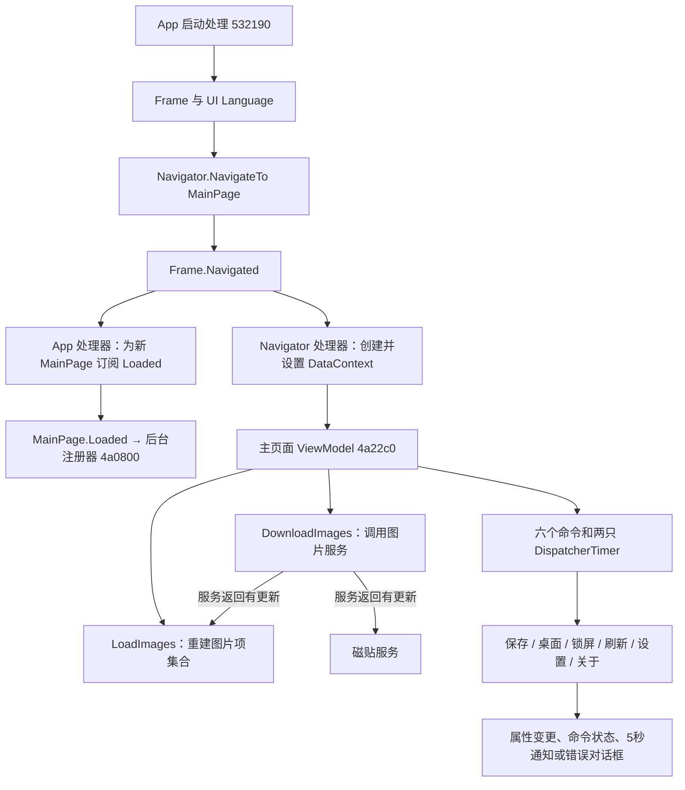

# Daily Picture：UI、启动、导航与命令层

本章复原安装版本 `1.4.13.0 x64` 的前台结构。它使用 XAML 页面、导航器、页面 ViewModel、委托命令和异步服务；图片下载、存储、个性化和磁贴工作由服务层承担。已恢复的主链是：**启动建立 Frame → 导航 MainPage → 按需注入 ViewModel → 初始读取和下载 → 图片集合/状态通知驱动界面；MainPage.Loaded 另触发后台任务注册**。

分析对象为安装目录内 `Duracellko.BingImage.Universal.dll`，SHA-256 为 `d9c4f3d1803ed27c3da21c1e70164423166c1460f53f0020f4ac2c68b413033a`，静态映像基址 `0x180000000`。本章的地址都是此映像的 VA；它们不是 ASLR 后的现场地址。本轮没有执行该应用、调用保存/壁纸 API 或修改设置。本文的 `LoadImages`、`MainViewModel`、`NavigatorBase.Dispose` 等名称是由角色和代码语义恢复的分析名称；没有将它们冒称为目标 PDB 中保留的原始符号。

完整机器可读索引为 [findings.json](../evidence/architecture-ui/findings.json)、[68 个函数条目](../evidence/architecture-ui/functions.json) 和 [29 份 REA 记录的溯源](../evidence/architecture-ui/provenance.json)。每份原始 REA JSON 保留完整指令输出、Evidence ID、命令和前后 SHA-256。WinRT 方法名称由[本机 WinMD 元数据](../evidence/architecture-ui/system-winmd.json)与[目标内 IID、类型指针和调用槽位](../evidence/architecture-ui/abi-evidence.json)交叉校验；WinMD 用 PEReader 读取，没有执行目标代码。

图中的两个 `Navigated` 处理器、加载与下载是独立路径；箭头表示静态调用/事件连接，不能据此推断所有异步步骤严格串行。

## UIA-01：页面与组件边界

三个导航目标不是仅从字符串猜测出来的：`0x1804a1cb0` 按页面名比较，返回三个具体运行时类型；相应页面载入路径又指向包内 XAML URI。[页面解析证据](../evidence/architecture-ui/navigation-page-resolver.json)，Evidence ID `ev_7f6405f518a5e50239bba26e383d1ca925d780d4d9c8b09c4dbf69fc4cf8f76c`。

| 组件 | 责任与实现边界 | 地址/类型 | 直接证据 |
|---|---|---|---|
| App 启动处理 | 两个旧设置迁移、Frame 创建、语言、事件、首次导航与 Window.Activate | `0x180532190` | [启动](../evidence/architecture-ui/app-lifecycle-candidate.json) |
| MainPage | 包内主界面；一次性装载 `ms-appx:///Views/MainPage.xaml` | 初始化 `0x1804a6180`；页面类型 `0x18001b6f0`；装载标志 `+0x98` | [MainPage](../evidence/architecture-ui/mainpage-xaml-load.json)，`ev_cf85e7041c6b9a81cb9998e31ff9157cad6487e29d78db47c0fd1c1e6c2c6ad0` |
| ApplicationSettingsPage | 设置页面；装载 `ms-appx:///Views/ApplicationSettingsPage.xaml` | 工厂 `0x1804a6750`；类型 `0x18001b588`；装载标志 `+0x58` | [Settings/About](../evidence/architecture-ui/settings-and-about-xaml-load.json)，`ev_746d0306e1e64a11dab13d033ce72bd432b99f2ac7d0ea9b93cdabfce4c48fb6` |
| AboutPage | 静态介绍、作者/Bing/隐私链接资源；此处 VM 工厂返回 null | 工厂 `0x1804a67d0`，初始化 `0x1804a6800`；类型 `0x18001b170`；装载标志 `+0x90` | 同上及 [ViewModel 工厂](../evidence/architecture-ui/viewmodel-factory.json) |
| Navigator | 页面名→类型→Frame.Navigate；为新页面注入 DataContext；转发导航事件；返回命令的服务端 | `0x1804a1cb0`、`0x1804a9930`、`0x1804a9a60` 等 | [导航基类](../evidence/architecture-ui/navigator-base.json) |
| 主页面 ViewModel | 图片项集合、选择、描述、忙碌状态、六命令、通知、前台定时刷新 | 构造 `0x1804a22c0` | [主 VM 构造](../evidence/architecture-ui/mainvm-constructor.json) |
| 图片项 ViewModel | 持有图片记录与图片服务，供列表中的图片项使用 | 构造 `0x1804a3790`，记录 `+0x10`、服务 `+0x18` | [选择/图片项](../evidence/architecture-ui/mainvm-selection-navigation.json) |
| 设置 ViewModel | 读取初始设置与能力、向服务转交两个布尔设置、提供返回命令 | 构造 `0x1804a1f80`，setter `0x1804a9740` / `0x1804a97e0` | [工厂](../evidence/architecture-ui/viewmodel-factory.json)、[setter](../evidence/architecture-ui/settings-vm-writes.json) |

`InitializeComponent` 的“已装载”检查是真实机器码分支；`ms-appx` URI 和 XBF 资源形成交叉证据。尚未解码所有 XBF 节点，不能把上表延伸成原始 XAML 文件或精确视觉树。

## UIA-02：启动、首次导航与 UI 语言

`0x180532190` 的主要顺序如下。[完整证据](../evidence/architecture-ui/app-lifecycle-candidate.json)，Evidence ID `ev_ec4ca01bd51f99b16983649e566c60e119d609e71611ae86e05593e3cb9324b2`。

1. 以 `UseBingImageAsLockScreen` 和 `CurrentLockScreenImageUrl` 两个键调用 `0x1804beb50`。这是从 RoamingSettings 向 LocalSettings 的迁移：来源非空时覆盖 Local 同名值，再向 Roaming 同键赋 null。不是全量迁移，也不是显式 `Remove`。数据层已单独恢复，见 [DATA-12](data-model-and-storage.md) 与[迁移原始证据](../evidence/architecture-data/settings-url-and-migrate.json)，`ev_47c402db3041bed79b42a93aef6ecf773a04a45de7384f3c0f44cbf8af89e42c`。
2. 取 `Window.Current.Content` 并尝试作为 Frame 使用。只有没有现成 Frame 时才创建新的 Frame，并执行下列语言、事件和导航器初始化。
3. 取 `ApplicationLanguages.Languages` 的第 0 项，写入 Frame 的 `Language`。`0x18053227a` 附近的索引参数为 0；`IApplicationLanguagesStatics` 的槽 8 是 `get_Languages`，`IFrameworkElement` 的槽 12 是 `put_Language`。目标内对应上下文是 `0x180110758` 和 `0x18010e028`，已用 IID 校验。这是 **XAML/UI 语言设置**；此路径没有将该字符串传入 HTTP 请求头或 market 参数，地区/网络问题见 [network-and-download.md](network-and-download.md)。
4. 订阅 Frame.NavigationFailed（处理器 `0x180531fe0`）和 App 的 Frame.Navigated（`0x180532060`）；创建并初始化导航器，再将 Frame 赋给窗口内容。
5. 若 Frame.Content 为 null，调用导航器到 `MainPage`，并转交 `ILaunchActivatedEventArgs.Arguments`；已有内容时跳过这次首次导航。最后调用 `IWindow.Activate` 槽 20。

`Language` 的确切运行时值仍由本机应用语言列表决定，本轮没有执行 getter 获取现场值。包内可见 UI 文案候选的 `Language=EN` 也不能单独证明用户实际看到的图片市场。

## UIA-03：导航后创建 ViewModel，页面 Loaded 后注册后台任务

这里存在两个容易混淆的事件连接，已按 IID 和方法槽位分开。

| 入口 | 条件与处理 | 证据 |
|---|---|---|
| App 的 Navigated，`0x180532060` | 读取 `NavigationEventArgs.Content`；若为 MainPage 且 `DataContext == null`，订阅该页面的 `Loaded` | [App 事件](../evidence/architecture-ui/navigation-startup-events.json)，`ev_54c1bb3769250104d07c6d40072c9e359db552ea4408e48ecfdd2964c8265690` |
| `0x1804c8fa0` / `0x1804c8f70` | 实际桥接 `IFrameworkElement.add_Loaded` / `remove_Loaded`，槽 43 / 44 | [事件桥接](../evidence/architecture-ui/data-context-event-wrappers.json)，`ev_219ade3705fddb9b929e3ff8352e8b7ac932101c8c05f89c22ad74c9cfc08970`；[ABI](../evidence/architecture-ui/abi-evidence.json) |
| MainPage.Loaded，`0x180531fb0` | 分配后台注册器对象，调用 `0x1804a0800` | [Loaded 处理器](../evidence/architecture-ui/mainpage-context-changed.json)，`ev_b7e1737ecdb5e8350a03db8d2da67a893bac45fc34cff46781aea1ef78382bb7` |
| Navigator 的 Navigated，`0x1804a9930` | 将事件 Content 转为 FrameworkElement；DataContext 空时根据运行时页面类型调用 VM 工厂，再 `put_DataContext`（槽 37）；之后转交 Content、NavigationMode 和 Parameter | [导航后处理](../evidence/architecture-ui/frame-on-navigated.json)，`ev_09badf7ad47e420a19444bc524803965e86ea0059cdcf465f03cb81fd358ada1` |

`mainpage-context-changed.json` 和 `data-context-event-wrappers.json` 保留了调查初期的文件名；它们对应的事件已经核实为 **Loaded**。这不是“DataContextChanged 触发后台注册”。启动代码先注册 App 的 Navigated，再由 Navigator 构造注册自己的 Navigated；本章只报告该静态注册顺序，不以此代替现场事件时间线。

## UIA-04：导航工厂、返回能力与异常边界

`0x1804a1cb0` 仅接受 `MainPage`、`ApplicationSettingsPage`、`AboutPage` 三个已恢复的页面名。未知名称抛 `ArgumentException("View was not found.", "viewName")`。`0x1804a1d50` 根据页面运行时类型创建 VM：主页面走 `0x1804a20e0`，设置页走 `0x1804a1df0`，AboutPage 返回 null；未知类型抛同类异常，参数名为 `viewType`。[类型/VM 工厂](../evidence/architecture-ui/viewmodel-factory.json)，`ev_f63b5d05cdcc8d83acf39dffd39d44f6549c26bb5bc17bf5f52737d4907fcfb1`。

Navigator 构造 `0x1804a9d10` 拒绝 null Frame，把 Frame 保存在对象 `+0x08` 并订阅 Navigated。`0x1804a9a60` / `0x1804a9c80` 先检查 `+0x10` 的 disposed 标志，再解析页面类型，进入 `0x1804a9ac0` 的 WinRT `IFrame.Navigate` 槽 24 桥接。disposed 时抛 `ObjectDisposedException("NavigatorBase")`。[导航基类证据](../evidence/architecture-ui/navigator-base.json)，`ev_b939d4042daeead7d5970785989e9b9d688a831ea690b4da753f086d68015eea`。

`0x180531e90` 的布尔参数控制释放路径：需要释放且此前未释放时取消 Frame.Navigated 的 `0x1804a9930` 订阅，然后设置 disposed 标志。这段证据原文件叫 `app-constructor.json`，但语义为 Navigator 的 `Dispose(bool)`，**不是 App 构造函数**。[释放证据](../evidence/architecture-ui/app-constructor.json)，`ev_bda048b4579340be4b5293ade7fd5e18a9436c60c289904e23e1dcdf18c68016`。尚未恢复所有调用此释放方法的现场条件。

平台初始化 `0x1804a5080` 获取 `Windows.UI.Core.SystemNavigationManager` 并安装事件委托；经 API 可用性检查后，还能安装 `Windows.Phone.UI.Input.HardwareButtons` 委托。[平台初始化](../evidence/architecture-ui/navigator-platform-init.json)，`ev_461a1b4803e0cd73476faa53b81a6ae906f9a7d95402d082ab82fc24b2175a53`。事件处理器的完整返回行为和系统返回按钮显隐尚未继续展开，不能仅凭类名报告本机一定呈现硬件返回入口。

导航失败处理器 `0x180531fe0` 读取失败页面类型，拼接 `Failed to load Page ` 与类型名称后抛异常；它不是本地错误对话框恢复路径。[App 事件证据](../evidence/architecture-ui/navigation-startup-events.json)。

## UIA-05：主 ViewModel 对象图、初始化和两只计时器

`0x1804a20e0` 显式创建服务对象图，传入 `0x1804a22c0`；未发现此段使用容器式依赖注入。UI 依赖通过对象字段和接口调用分离，不能据此推断原项目有几个源码工程或具体文件布局。

| 主 VM 偏移 | 已支持的责任 | 证据与使用点 |
|---|---|---|
| `+0x08` | 属性变化事件委托 | 多个 setter 调用，属性名为冻结字符串 |
| `+0x10` / `+0x78` | 可变图片项集合 / 对外 Images 包装 | 构造及加载状态机；选择、计数与索引路径 |
| `+0x18` | 图片业务服务 | 下载、读取图片列表、保存、锁屏、桌面命令 |
| `+0x20` | 磁贴服务 | 下载返回更新时通过分派单元 `0x180304940` 调用 |
| `+0x28` | 导航器 | 设置/关于命令 |
| `+0x30` / `+0x38` | 前台周期下载 / 通知消失 DispatcherTimer | 构造、Interval、Tick 与 Start/Stop |
| `+0x40` / `+0x48` / `+0x50` / `+0x58` | 保存 / 刷新 / 锁屏 / 桌面命令对象 | 六命令构造与 CanExecuteChanged |
| `+0x60` / `+0x68` | 设置 / 关于命令 | 仅执行委托，predicate 为 null |
| `+0x70` / `+0x71` | 下载中 / 加载中内部标志 | 两个异步状态机的开始和 finally |
| `+0x80` / `+0x84` | SelectedIndex / IsBusy | 属性 setter 与命令门控 |
| `+0x85` / `+0x88` / `+0x90` | ShowDescription / Description / NotificationMessage | 选择变化、描述与通知更新 |

字段映射的主要证据为[构造](../evidence/architecture-ui/mainvm-constructor.json)，Evidence ID `ev_b935c2021cb366198b42f33074e5afebf0cec6e15c9eb31b98e4fd8fb5df33d2`；[属性与加载](../evidence/architecture-ui/mainvm-property-and-refresh.json)，`ev_937c8d79fee30a39d849d4b17e2de267ee75c422a55ae353bf2e451fba332cd9`；[下载状态机](../evidence/architecture-ui/download-state-and-handlers.json)，`ev_6e2e44448eb75f94fa8ab47b9c42f374f0816f81e48ecff693e7dc11c397e1b5`。

构造将 SelectedIndex 设为 `-1`，先调用 `0x1804a31e0` 的 LoadImages，再调用 `0x1804a2a90` 的 DownloadImages。二者使用 `AsyncVoidMethodBuilder`，构造方没有等待第一个异步操作完成后再启动第二个；这解释了为何需要两个内部忙碌标志。[LoadImages 入口](../evidence/architecture-ui/refresh-command-entry.json)，`ev_17ba7054fb1aabe378a9e6d5691b149e8e680ea6f36bdc8eb6d3edd0fc5560a1`；[DownloadImages 入口](../evidence/architecture-ui/download-command-entry.json)，`ev_705feafd01585943f6f151136f5ca4ddd2d4b98fcb92658b367a217c088cee4d`。

两个 Interval 已从目标原始 double 常量和实际 `TimeSpan` 调用联合确定，而非从文案推测：

| 计时器 | 原始常量 | 设置/事件 | 实际静态含义 |
|---|---|---|---|
| 通知计时器 | `0x180144540`，`0000000000001440` → `5.0` | `0x1804a2856` 调 `TimeSpan.FromSeconds`；Tick=`0x1804a3910` | 消息置入后计时约 5 秒，再清空消息 |
| 前台下载计时器 | `0x180144548`，`000000000000f03f` → `1.0` | `0x1804a293a` 调 `TimeSpan.FromHours`；Tick=`0x180602cc0` 跳到 `0x1804a4680`；构造末尾 Start | 前台 ViewModel 的 1 小时周期刷新 |

常量的文件偏移、字节和关联 REA ID 保存在 [findings.json](../evidence/architecture-ui/findings.json)；[Tick 跳板](../evidence/architecture-ui/timer-download-thunk.json)，`ev_4cff0cacc642098971aabefc46ded9ce0ee85dcb820f637671d2a5a2126b726d`。`IDispatcherTimer` 的 IID 已匹配，槽 7 为 Interval setter，槽 9/10 为 Tick 增删，槽 11/12 为 Start/Stop。这里的 1 小时不是后台任务触发器的间隔，也不是应用关闭后仍保证发生的刷新。

## UIA-06：加载、下载与磁贴之间的异步关系

`LoadImages` 状态机 `0x1804a3290` 设置“加载中”和 IsBusy，调用图片服务异步获取记录集合。返回后清空 VM 的可变集合，为各记录创建图片项 ViewModel（`0x1804a3790`），再加入集合；有记录时选择最后一项 `Count - 1`，随后通知 `IsBackgroundVisible`。finally 清除加载标志，并以“下载中”恢复 IsBusy。排序/记录含义由数据层决定，UI 此处不独立重新按日期排序。[加载与属性证据](../evidence/architecture-ui/mainvm-property-and-refresh.json)。

`DownloadImages` 状态机 `0x1804a2b50` 在进入时检查内部“下载中”标志，已在下载则跳过本次工作。开始时设置下载标志和 IsBusy，等待图片服务的布尔结果；结果为 true 时调用 LoadImages，并设置随后需要更新磁贴的标志。下载 finally 清除下载标志，以“加载中”恢复 IsBusy；之后根据更新标志调用磁贴服务并等待完成。[下载证据](../evidence/architecture-ui/download-state-and-handlers.json)。

这两条 finally 路径使 IsBusy 在主要加载/下载流程中表达两者的合并忙碌状态，但**不能据此说 IsBusy 一直覆盖磁贴更新、保存和所有系统对话框**。下载状态机先恢复其忙碌状态，之后才进入磁贴调用。前台计时器直接调用 Refresh 的执行入口；该执行入口再调用 DownloadImages，而不是先调用 Refresh.CanExecute，因此内部“下载中”检查仍有独立意义。

下载服务异常有用户消息分支：`0x1804a2d19` 读取 `DownloadImagesErrorMessage`，交给通知显示函数，随后走清理路径。LoadImages 的外层异常 funclet `0x1804a357e` 则进入 `AsyncVoidMethodBuilder.SetException`；已检查路径没有同等的“读取列表失败”文案分支。不能把 REA 中的 async 结构称为“所有异常都会被 UI 吞掉”。[完整 LoadImages 外层异常](../evidence/architecture-ui/load-unhandled-exception.json)，`ev_fec1cc61e065f226bd5c9f09e176f6e206b385f668c33d769b7d2550f3d9ac7d`。

## UIA-07：命令合同、选择与状态通知

命令对象使用同一 EEType `0x18001c898`：执行委托位于 `+0x08`，可选判定委托位于 `+0x10`，状态变化事件位于 `+0x18`。两个构造函数 `0x1804a8840` / `0x1804a88b0` 检查 execute 非空，否则抛 `ArgumentNullException("execute")`。主 VM 内构造已被部分内联。[命令对象构造](../evidence/architecture-ui/command-event-plumbing.json)，`ev_2411203e56e03275de03c3fa78e356d6ec066ed1b44b06e95946fae7ee1aa20e`。

| XAML/VM 合同名称 | 主 VM 字段 | 执行入口 | CanExecute 判定入口与条件 |
|---|---|---|---|
| `RefreshCommand` | `+0x48` | `0x1804a4680` → DownloadImages | `0x1804a4670`：`!IsBusy` |
| `SaveCommand` | `+0x40` | `0x1804a46b0` | `0x1804a4690`：`SelectedIndex >= 0 && !IsBusy` |
| `SetLockScreenImageCommand` | `+0x50` | `0x1804a41a0` | `0x1804a4170`：选中项非负、非忙碌、服务能力查询为真 |
| `SetDesktopBackgroundImageCommand` | `+0x58` | `0x1804a3a20` | `0x1804a39f0`：选中项非负、非忙碌、服务能力查询为真 |
| `OpenSettingsCommand` | `+0x60` | `0x1804a39c0` → `ApplicationSettingsPage` | 构造未设置 predicate |
| `OpenAboutCommand` | `+0x68` | `0x1804a3990` → `AboutPage` | 构造未设置 predicate |

证据：[保存/刷新门控](../evidence/architecture-ui/save-refresh-command-gates.json)，`ev_70c1897b8458216c820a6aa03a0f16237a996820ab3070f60e907744d0389661`；[桌面](../evidence/architecture-ui/personalization-command-flow.json)；[锁屏](../evidence/architecture-ui/lockscreen-command-flow.json)；[六命令构造](../evidence/architecture-ui/mainvm-constructor.json)。谓词中的选中项检查是 `>= 0`，本章不把它扩大成完整范围校验；图片集合正常更新时由 LoadImages 设置选中项。

`IsBusy` setter `0x1804a2db0` 只在值变化时发送 `PropertyChanged("IsBusy")`，再使刷新、保存、锁屏、桌面这四个命令重查可执行状态。`SelectedIndex` setter `0x1804a35b0` 发属性通知后进入 `0x1804a3610`：清除 ShowDescription；索引在集合范围内时从选中图片记录取描述，更新 Description；最后通知保存、锁屏、桌面三命令。Description setter `0x1804a3720` 也用字符串比较避免重复通知。[选择变化证据](../evidence/architecture-ui/mainvm-selection-navigation.json)，`ev_6c990d88120eed1a8a55b347f36aae7c2edc4c4e56fc1677797ac35539b06384`。

这些是事件与数据合同，不等于已恢复所有 XAML Binding.Mode、转换器参数或每个控件的命令绑定节点。`ShowDescription` 的完整触发展示机制尚未恢复；已证明的是选中项改变时清除此标志。

## UIA-08：保存图片流程与取消语义

保存命令 `0x1804a46b0` 进入状态机 `0x1804a4760`。它从 `Images[SelectedIndex]` 取图片记录，创建 FileSavePicker；用记录的文件名得到扩展名，以 `ImageFileTitle` 作为文件类型显示名称，设置默认扩展名、建议文件名和建议位置。建议位置的数值为 6，本机 WinMD 枚举证明它是 `PickerLocationId.PicturesLibrary`。[完整保存状态机](../evidence/architecture-ui/save-command-state.json)，`ev_d232ff95fe48076c8ff64d19779dd846fe895a0f6dfa4ea1bcfb57d336b85914`；[枚举与接口元数据](../evidence/architecture-ui/system-winmd.json)。

`IFileSavePicker` 槽 12/14/18/19 对应 FileTypeChoices、DefaultFileExtension setter、SuggestedFileName setter 和 PickSaveFileAsync；建议位置 setter 为槽 9。选择完成后：

- 返回 null：跳过服务写出和“已保存”消息，构成取消分支。
- 返回 StorageFile：调用主 VM 图片服务的分派单元 `0x1803083e0`，传入图片记录和选定文件并等待；成功后取目标路径格式化 `ImageSavedMessage`，交给 5 秒通知。
- 服务或选择流程出现可捕获错误：保存异常消息，格式化 `SaveErrorMessage`，与 `ErrorTitle` 构造 MessageDialog，并调用 ShowAsync。外层尚有 AsyncVoid.SetException 路径，不能保证错误对话框自身再失败时仍被本地恢复。

此处“选择目的文件”和“从本地图片源复制内容”分属 UI 与图片服务。数据复制的具体失败边界见 [数据与存储](data-model-and-storage.md)。这些路径均为静态恢复，本轮没有弹出选择器或写入用户选定位置。

## UIA-09：桌面、锁屏命令与系统服务边界

桌面命令入口 `0x1804a3a20` / 状态机 `0x1804a3ae0`，锁屏命令入口 `0x1804a41a0` / 状态机 `0x1804a4260`，均读取当前图片记录，调用图片服务的相应异步操作并等待。成功后分别读取 `DesktopBackgroundSetMessage`、`LockScreenSetMessage`，再调用通知函数 `0x1804a2e90`。异常路径取异常消息，套入对应错误模板，用 `ErrorTitle` 显示 MessageDialog。

桌面完整证据：[personalization-command-flow.json](../evidence/architecture-ui/personalization-command-flow.json)，`ev_ffe7627546246acd6f1c810c969b314cb4e138bca535c877bc2d6318e4dff45c`。锁屏完整证据：[lockscreen-command-flow.json](../evidence/architecture-ui/lockscreen-command-flow.json)，`ev_287e407f178f62cb4ef106503aa21d23eed2e172124bba92a3be590a8f0feacf`。对话框 ShowAsync 使用已匹配的 `IMessageDialog` 槽 15。平台能力与真正的系统图片设置操作在服务层；UI 层的成功提示只能证明该分支会显示的文案，不能代替本机壁纸实际更换的运行时证据。

## UIA-10：通知是可替换的单条状态

通知显示函数 `0x1804a2e90` 先在旧消息非空时清旧值并发属性通知，再停止通知计时器；新字符串非空时调用 `0x1804a2f50` 更新 NotificationMessage，并重新 Start 计时器。Tick `0x1804a3910` Stop 自身，清 `+0x90`，发送同名属性变化。因此这是**替换当前消息并重新计时**的设计；在这条路径没有发现通知队列。

证据：[属性/通知](../evidence/architecture-ui/mainvm-property-and-refresh.json)，`ev_937c8d79fee30a39d849d4b17e2de267ee75c422a55ae353bf2e451fba332cd9`；[Tick](../evidence/architecture-ui/mainvm-selection-navigation.json)，`ev_6c990d88120eed1a8a55b347f36aae7c2edc4c4e56fc1677797ac35539b06384`。5 秒由 UIA-05 的原始数值与 FromSeconds 调用证明，不是保证系统暂停或繁忙时仍准确在第 5 秒绘制消失。

## UIA-11：设置页、读取与写入责任

`0x1804a1df0` 为设置页创建服务对象，`0x1804a1f80` 将服务保存在 VM `+0x10`、导航器在 `+0x18`、GoBack 命令在 `+0x20`，并从服务读取初始能力/设置状态。返回命令的 predicate `0x1804a20a0` 要求导航器非空并返回可后退；执行委托 `0x1804a20c0` 则转发导航器返回操作。[设置 VM 构造](../evidence/architecture-ui/viewmodel-factory.json)，`ev_f63b5d05cdcc8d83acf39dffd39d44f6549c26bb5bc17bf5f52737d4907fcfb1`。

| 设置属性 | VM 字段 / setter | setter 行为 |
|---|---|---|
| `UseBingImageAsLockScreen` | `+0x28`，`0x1804a97e0` | 值变化才更新字段、发同名 PropertyChanged，再通过 `0x180305da0` 向服务传递 bool |
| `UseBingImageAsDesktopBackground` | `+0x2a`，`0x1804a9740` | 值变化才更新字段、发同名 PropertyChanged，再通过 `0x180307fa0` 向服务传递 bool |

证据：[设置 setter](../evidence/architecture-ui/settings-vm-writes.json)，`ev_1f9de9bdce96c1bbca57201e0f50c3abbdc3eee87cd440b0cce8ffa3e771a360`。setter 本身直接转交服务，没有本地“先弹确认框”或错误回滚分支。持久化位置、默认值和平台更新语义见 [DATA-10/11](data-model-and-storage.md)；不能仅根据 ToggleSwitch 字符串就认定每次点击一定完成系统图片更新。

## UIA-12：XBF/XR 合同和资源字段

资源是交叉证据，不能独立还原行为。已解析的 5 个 XBF 是 2.1 格式，共 172 条字符串，元数据与节点区边界通过文件长度检查；节点流没有全面解码。[XBF 元数据及原文件哈希](../evidence/resources/xbf-metadata.json)、[XAML 编译根描述 XR](../evidence/resources/original/Duracellko.BingImage.Universal.xr.xml)、[PRI 候选原表](../evidence/resources/resource-candidates.json)。

| 资源/合同 | 确定存在的内容 | 可支持的架构结论与限制 |
|---|---|---|
| `App.xbf` | `Resources/Resources.xaml`，BooleanConverter、VisibilityConverter、NullToVisibilityConverter | 全局字典和三转换器的资源合同；转换器完整计算语义未解码 |
| `MainPage.xbf` | imagesFlipView、Images、SelectedIndex、ImageSource、Description、IsBusy、IsBackgroundVisible、NotificationMessage；六命令名称 | 图片浏览、状态和命令合同；native setter/命令补足行为证据 |
| `MainPage.xbf` 自适应相关名称 | Large720、主/次级 Save 与 Settings 按钮、Visibility/Visible/Collapsed | 存在相关视觉状态目标；不能仅从 Large720 名字断言精确宽度阈值、优先级或完整转换规则 |
| `ApplicationSettingsPage.xbf` | 两个 UseBingImageAs… 属性、标题/说明资源名 | 设置合同；native setter 证明这两个属性可写，Binding.Mode 未恢复 |
| `AboutPage.xbf` | 介绍、应用名、版权、隐私、Bing 和作者地址 | 静态介绍和链接资源；不将链接资源冒称遥测请求 |
| XR RootTypes | FlipView.ItemsSource/SelectedIndex/ItemTemplate；Image.Source/Stretch/Loaded/Unloaded；ProgressBar.IsIndeterminate/Visibility/ShowPaused；AppBarButton.Command；ToggleSwitch.IsOn | 编译保留的类型/成员需求集合，**不是控件实例树** |

33 个 String 候选均带 `Language=EN`；完整资源 URI、值与 qualifier 已另列 [resource-fields.json](../evidence/architecture-ui/resource-fields.json)，可由 PRI 原表复查。下表覆盖这些字段，`/` 前后是资源对象/属性路径；模板中的 `\n` 表示换行。

| 字段 | 值 / 作用 |
|---|---|
| AboutApplicationAppBarButton/Label；AboutSettings/Title；AboutTitle/Text；AboutSettingsTitle | `About` |
| AboutApplicationTitle/Text；LiveTileText | `Daily Picture` |
| AboutApplicationDescription/Text | 说明显示每日 Bing 图片和动态磁贴，并可每天更换锁屏/桌面；精确英文全文保存在资源字段 JSON |
| ApplicationOptions/Title；ApplicationOptionsTitle | `Options` |
| Copyright/Text | `Copyright © Duracellko.NET 2013`；资源文案不等于此二进制构建年份 |
| RefreshAppBarButton/Label | `Refresh` |
| SaveAppBarButton/Label | `Save` |
| SetDesktopBackgroundImageAppBarButton/Label | `Set desktop wallpaper` |
| SetLockScreenImageAppBarButton/Label | `Set lock screen` |
| SettingsAppBarButton/Label；SettingsTitle/Text | `Settings` |
| UseBingImageAsDesktopBackgroundTitle/Text | `Use Bing image as desktop wallpaper` |
| UseBingImageAsDesktopBackgroundDescription/Text | `Change your desktop wallpaper to actual Bing image daily` |
| UseBingImageAsLockScreenTitle/Text | `Use Bing image as lock screen` |
| UseBingImageAsLockScreenDescription/Text | `Change your lock screen to actual Bing image daily` |
| DesktopBackgroundSetMessage | `Desktop background was set successfully.` |
| LockScreenSetMessage | `Lock screen was set successfully.` |
| DownloadImagesErrorMessage | `Downloading of Bing images failed. Check your internet connection.` |
| ErrorTitle | `Error` |
| ImageFileTitle | `Image` |
| ImageSavedMessage | `File '{0}' was saved.` |
| SaveErrorMessage | `Error saving image:\n{0}\n\nPlease, try again.` |
| SetDesktopBackgroundErrorMessage | `Error setting your desktop background image:\n{0}` |
| SetLockScreenErrorMessage | `Error setting your lock screen image:\n{0}` |
| PrivacyPolicyHyperlink/Content；PrivacyPolicy | `Privacy policy` / `Privacy Policy` |
| PrivacyPolicyHyperlink/NavigateUri；PrivacyPolicyUrl | `http://www.duracellko.net/privacy-policy`，只是包内链接值，本轮未打开该站点 |

## UIA-13：图片显示与释放的后续补证

此前只靠 XBF/XR 保留声明的 ImageSource 和 Image.Loaded/Unloaded，现已与完整 native 方法连接。图片项 getter `0x1804a9680` 在 Source 为空时进入 `0x1804a8a30 / 0x1804a8af0`；状态机等待服务返回流、创建 BitmapImage、等待 SetSourceAsync 后才赋值并通知，最后显式 Dispose 流。异常展开也对取得的非空流执行清理。UI 所用接口 cell 到本地流生产实现的具体 Native dispatch 槽仍未完全映射，不能冒称两者之间已解出直接 call。

生成连接器 `0x1804c8c40` 的第 8 个分支注册 Loaded `0x1804c88e0` 与 Unloaded `0x1804c86e0`。Loaded 观察 SourceProperty 并把 token 存到 Tag；完整 Unloaded 只注销该属性回调，不清空图片源、Tag 或取消加载。SourceProperty 变化经 Dispatcher 排入的动作会有条件地修正末项选择，并把该图片项存到 MainPage+0x58；该引用可能在主 VM 集合 Clear 后继续持有旧图片项。

因此必须分开临时流 Dispose、控件属性回调注销、集合引用清除和显示对象最终回收。Source 尚为空时再次调用 getter 还可启动独立加载；已覆盖链没有共享加载 Task 或取消令牌源。完整字段、接口、失败矩阵和剩余运行时边界见 [IMG-01～09](image-loading-and-lifetime.md)，原始机器证据入口为 [image-load-state.json](../evidence/image-lifetime/image-load-state.json) 与 [image-unloaded-handler.json](../evidence/image-lifetime/image-unloaded-handler.json)。

## UIA-14：App 挂起与恢复的后续补证

App 真正构造为 `0x180461e60`，由分配回调 `0x180461e40` 创建；类型和 OnLaunched 覆盖槽均已核对。构造确实订阅 Suspending，handler `0x180461f60` 的完整已解正常路径仅执行 `args.SuspendingOperation.GetDeferral().Complete()`，没有保存状态、等待异步下载、Stop 或 Dispose；托管 EH 表未完整解析，未据此排除所有异常处理。OnLaunched 新建 Frame 的分支读取 PreviousExecutionState，但不使用返回值恢复导航栈；旧 Frame 复用只说明当前对象仍存在。

Resuming、LeavingBackground、EnteredBackground 和 UnhandledException 的框架包装器均已识别，但已覆盖的 App 构造/启动链没有相应应用注册。该结论保留间接分派和其他未恢复入口的范围限制。详见 [LIFE-01～11](suspend-and-resume.md)；关键原始证据为 [真实构造与挂起完整函数](../evidence/app-lifecycle/app-constructor-real.json) 和 [启动局部伪代码](../evidence/app-lifecycle/onlaunched-pseudocode.json)。

## UIA-15：计时器清理方法存在，自动调用链仍有缺口

主 VM EEType `0x18001c678` 的 IDisposable 类型和相对方法表对应到完整入口 `0x180531e10`。该函数对 VM+0x30 与 +0x38 两只 DispatcherTimer 顺序调用 Stop，再 `GC.SuppressFinalize(this)`；没有 Tick 退订、字段清零、disposed 标志或取消在途异步工作。构造提供的 remove_Tick 委托是 AddEventHandler 的注册参数，不能当成已经执行退订。

另外，导航器的具体 OnNavigated 覆盖 `0x1804a1c30` 已完整恢复，只根据 CanGoBack 更新系统返回按钮显隐。Navigator.Dispose 只解除自己订阅的 Frame.Navigated；App.Dispose 清理其 Navigator 字段。这些已覆盖路径没有获取旧页面 DataContext 并调用主 VM.Dispose，挂起 handler 也没有调用它。元数据表证明可间接分派，但尚不足以确认谁在运行中调用清理。

ShowNotification 不检查 disposed 状态，而 Dispose 也没有设置该状态；因此在途异步完成分支若在 Dispose 后继续通知，非空消息仍可重新 Start 通知计时器。这是有条件的控制流推导，尚未复现。双 Stop 的异常顺序、委托引用、调用者检查范围与多实例边界见 [TIMER-01～08](timers-and-disposal.md)；准确指令见 [78 字节 Dispose](../evidence/timer-cleanup/mainvm-dispose-instructions.json)。

## 尚未恢复的细节与证据命名修正

本章及三份后续专题已经覆盖可验证的启动/导航、VM 创建、主要命令、加载/下载协调、图片加载、挂起 handler、计时器清理、通知、设置和资源合同；下列内容仍需新的定向证据，不能标为已恢复：

- 其他应用激活/生命周期间接分派、App.Dispose 的自动调用者、系统挂起/终止/恢复的现场行为；已恢复的完整挂起 handler 和启动入口没有自定义 UI 状态保存/恢复。
- 图片服务具体 Native dispatch 实现槽、FlipView 虚拟化/容器缓存、最后一条对象引用与渲染资源的实际释放时点；getter、BitmapImage 创建、流清理和 Loaded/Unloaded 本体已恢复。
- XBF 完整节点树、每条 Binding.Mode、ConverterParameter、所有视觉状态阈值、焦点/键盘/触摸事件。
- 返回事件处理器未覆盖的细节、Main VM Dispose 的所有调用者，以及是否存在其他间接退订路径；已恢复的主 VM 清理本体只有双 Stop，所检查导航/挂起链没有连到它。
- 所有运行时异常类型、OS 权限拒绝、对话框取消、系统挂起时异步竞态与 UI 绘制时序；静态路径不保证所有现场结果。

证据文件名保留调查历史，最终解释以本文和 [provenance.json](../evidence/architecture-ui/provenance.json) 为准：`app-constructor` 实际为 Navigator.Dispose；`refresh-command-entry` 实际为 LoadImages 入口；`mainpage-context-changed` 实际为 MainPage.Loaded；`command-event-plumbing` 实际为命令构造；`command-canexecute` 实际是 `Images.Count == 0` 的 getter（结合合同推定为 IsBackgroundVisible）；`command-execute` 只是主 VM 服务能力转发，未认定为 ICommand.Execute。`load-failure-cleanup` 的末段落在异常 funclet 中间，完整尾部另存 `load-unhandled-exception`。**REA 提供方返回 complete 表示所请求命令完成，不表示所请求字节区间自动覆盖整个逻辑方法。**

重建本章索引可运行 `python -X utf8 scripts/ui_arch_catalog.py`；该脚本复核目标 SHA、所有 29 个原始 REA 记录的完成/未截断/未修改标志、函数的 `.pdata` 起点与对应证据覆盖范围，并重新输出函数表、常量和资源字段。WinMD ABI 提取入口是 `scripts/ui_arch_winmd.ps1` 与 `scripts/ui_arch_abi.py`；原始反汇编采集入口为 `scripts/ui_arch_inspect.py`。
